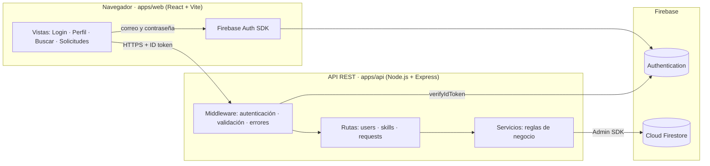
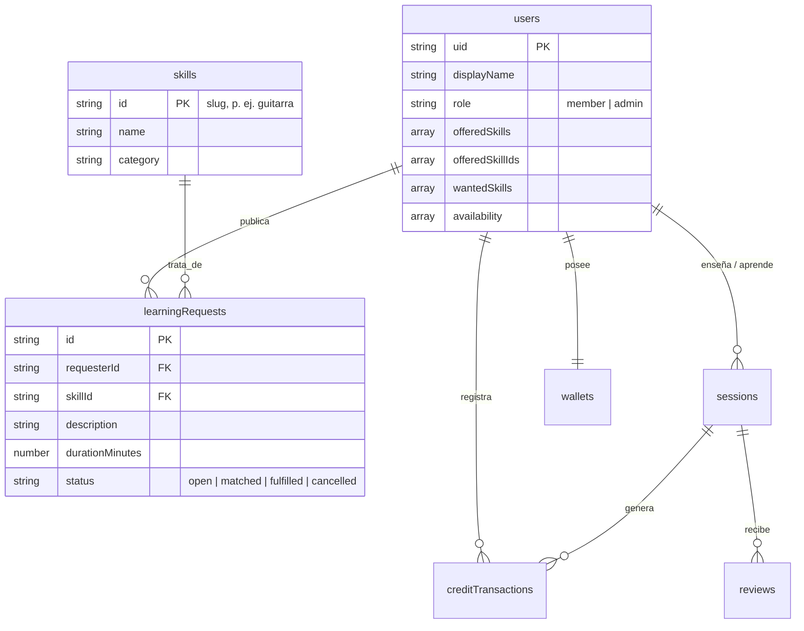

# SkillBarter · Guía de la Revisión 1 (R1)

**Jueves 19 de noviembre de 2026 · Arquitectura y primera operación con Firebase · Pondera 25 %**

> Proyecto 08 del documento *«10 Proyectos Innovadores Full Stack»* — Lenguajes Modernos de Programación.
> Flujo obligatorio del proyecto: **Sesión → confirmación → créditos**. Innovación verificable: **coincidencia y saldo seguro**.

---

## 0. Qué se evalúa en R1 y cómo usar esta guía

### 0.1 Entregables de R1 (extraídos del PDF)

| # | Entregable | Dónde queda en el repositorio | Paso de esta guía |
|---|---|---|---|
| 1 | README con problema, objetivo, alcance del MVP, roles, integrantes y tecnología | `README.md` | §9.1 |
| 2 | Al menos **5 historias de usuario** | `docs/historias-usuario.md` | §9.2 |
| 3 | **Diagrama de componentes** | `docs/arquitectura.md` | §9.3 |
| 4 | **Modelo inicial de Firestore** | `docs/modelo-firestore.md` | §9.4 |
| 5 | **Diseño navegable de 4 pantallas** | `apps/web/` (app en vivo) + bocetos en `docs/arquitectura.md` | §8 y §9.5 |
| 6 | Proyecto ejecutable con **autenticación, primer rol y una operación de alta/consulta persistente** | `apps/api/`, `apps/web/` | §5–§8 |
| 7 | `docs/revisiones/R1.md` con evidencias y enlace al tag `revision-1-2026-11-19` | `docs/revisiones/R1.md` | §11 |
| **Específico SkillBarter** | **Perfiles, catálogo de habilidades, búsqueda y alta de solicitudes almacenadas en Firestore** | rutas `users`, `skills`, `requests` | §5 |

### 0.2 Cómo se califica (R1 vale 100 puntos)

| Criterio | Puntos | Qué hace que lo obtengan |
|---|---|---|
| Entregables implementados y completos | 40 | La tabla anterior, completa |
| Demostración y comportamiento funcional real | 25 | Datos que se guardan **en Firestore real** (se ven en la consola), no arreglos fijos |
| Calidad técnica, validaciones y seguridad | 15 | Validación en el servidor, token verificado, rol decidido por el servidor, `.env` fuera de Git |
| GitHub: commits, PR, tag y evidencias | 10 | Ramas `feature/*`, PR hacia `develop`, tag `revision-1-2026-11-19`, `R1.md` |
| Explicación y participación de integrantes | 10 | Cada persona explica **su** código y **sus** PR |

> **No se considera entrega:** una interfaz con datos simulados como única evidencia, código sin subir a GitHub, commits sin correspondencia con lo presentado, documentación que no permita ejecutar el proyecto o funciones que solo trabajan en la computadora de un integrante.

### 0.3 Estado de verificación de esta guía (lectura obligatoria)

Todo el código de esta guía fue **construido y ejecutado** antes de escribirla, en Linux con Node 22, Java 21 y los emuladores de Firebase:

- ✅ **15 pruebas automatizadas de R1 en verde** (la rúbrica pide ≥ 10 al terminar R3).
- ✅ Frontend compilado con Vite y recorrido con un navegador real (registro → perfil → búsqueda → solicitud) contra los emuladores de Auth y Firestore, con tokens reales del emulador.
- ✅ Los comandos `curl` de §5.8 se ejecutaron y las salidas mostradas son reales.
- ⚠️ **No pude verificar**: la creación del proyecto en la consola de Firebase (los nombres de menús pueden cambiar), `firebase deploy`, GitHub Actions y la ejecución en Windows/macOS. Esos pasos están escritos con cuidado, pero **pruébenlos hoy mismo**, no mañana.

### 0.4 Prioridades si el tiempo no alcanza

R1 es **mañana**. Si algo se complica, sacrifiquen en este orden (de lo último a lo primero):

1. ✂️ Pulido visual y bocetos extra.
2. ✂️ `docs/historias-usuario.md` con más de 5 historias (las 5 primeras bastan).
3. ✂️ Edición del perfil (dejar solo el alta).
4. 🚫 **No sacrificar**: autenticación, Firestore real, búsqueda, alta de solicitud, README, `R1.md`, tag.

---

## 1. Organización del equipo (5 integrantes)

El PDF exige **responsabilidades explícitas y participación verificable**: cada persona debe tener ramas y PR propios.

| Persona | Rol | Ramas principales en R1 | Entrega visible |
|---|---|---|---|
| **P1** | Líder de repositorio y documentación | `feature/repo-docs` | README, plantilla de PR, docs/, `R1.md`, tag |
| **P2** | Backend núcleo | `feature/api-base` | Express, autenticación, middleware, errores |
| **P3** | Backend de datos y Firebase | `feature/api-users-skills`, `feature/firebase-rules` | Firestore, reglas, perfiles, catálogo, *seed* |
| **P4** | Frontend base | `feature/web-base`, `feature/web-profile` | Vite, Firebase Auth, rutas, Login, Perfil |
| **P5** | Frontend de funcionalidades y QA | `feature/web-search-requests` | Buscar, Solicitudes, pruebas, capturas |

**Reglas de oro** (el docente revisa el historial):

1. Nadie hace *push* directo a `main` ni a `develop`: todo entra por *pull request*.
2. Cada PR lo revisa **otra** persona (comentario o *approve*).
3. Mensajes de commit con prefijo: `feat:`, `fix:`, `docs:`, `test:`, `chore:`.
4. Cada integrante configura su identidad real **antes** de hacer commits:

```bash
git config --global user.name "Nombre Apellido"
git config --global user.email "correo-asociado-a-tu-github@ejemplo.com"
```

### 1.1 Cronograma sugerido (≈ 10 h de trabajo en paralelo)

| Bloque | Duración | P1 | P2 | P3 | P4 | P5 |
|---|---|---|---|---|---|---|
| **A. Arranque** (secuencial) | 1 h | Repo + esqueleto raíz (§2–§3) | Instala herramientas | Crea proyecto Firebase (§4) | Instala herramientas | Instala herramientas |
| **B. Núcleo** | 3 h | README + historias | API base (§5.2, 5.5) | Esquemas, usuarios, skills, reglas (§5.3–5.6) | Vite, Auth, Login, rutas (§7.1–7.5) | Pruebas (§6) |
| **C. Funcionalidad** | 3 h | Arquitectura + modelo | Requests (§5.4) | *Seed* y despliegue de reglas | Perfil (§7.5) | Buscar + Solicitudes (§7.6–7.7) |
| **D. Integración** | 2 h | Revisa y fusiona PR | Corrige | Corrige | Corrige | Verificación manual (§8 y §10) |
| **E. Evidencia** | 1 h | `R1.md`, capturas, tag (§11) | Ensayo de demo (§12) | Ensayo | Ensayo | Ensayo |

---

## 2. Prerrequisitos y repositorio [P1 + todos]

### 2.1 Herramientas (todo el equipo)

| Herramienta | Versión | Para qué | Cómo comprobar |
|---|---|---|---|
| **Node.js** | **22 LTS** (mínimo 20.19) | Backend y Vite | `node -v` |
| **npm** | 10 o superior | Dependencias | `npm -v` |
| **Git** | 2.40+ | Control de versiones | `git --version` |
| **Java (JDK)** | **21** | El emulador de Firestore corre en Java | `java -version` |
| Cuenta Google | — | Proyecto Firebase | — |
| Editor | VS Code (recomendado) | — | — |

> En **Windows** usen **Git Bash** o **WSL** para copiar los comandos `bash` y `curl` de esta guía tal cual.

### 2.2 Clonar y preparar ramas (solo P1, una vez)

El remoto del equipo es `https://github.com/legarciabal-coder/skillBarter`. Su rama estable es **`main`** (el PDF la llama `master`; son equivalentes — si su docente exige literalmente `master`, renómbrenla con `git branch -m main master && git push -u origin master`).

```bash
git clone https://github.com/legarciabal-coder/skillBarter.git
cd skillBarter
git checkout -b develop          # rama de integración
git push -u origin develop
```

En GitHub → **Settings → Branches → Add branch ruleset** (o *branch protection rule*) para `main` y `develop`: marcar **Require a pull request before merging**. Así el historial queda auditable.

Cada integrante, después:

```bash
git clone https://github.com/legarciabal-coder/skillBarter.git
cd skillBarter
git checkout develop
git pull
git checkout -b feature/<nombre-de-su-rama>      # ver tabla de la sección 1
```

### 2.3 Flujo diario (se repite en cada tarea)

```bash
git checkout develop && git pull                 # 1. actualizar
git checkout -b feature/mi-tarea                 # 2. rama de trabajo
# ... editar ...
git add -A
git commit -m "feat: descripción corta de lo hecho"
git push -u origin feature/mi-tarea              # 3. subir
# 4. abrir PR en GitHub: base = develop, compare = feature/mi-tarea (o con gh CLI):
gh pr create --base develop --title "feat: ..." --body "Qué cambia y cómo probarlo"
```

Plantilla de PR (crearla en `.github/pull_request_template.md`):

````markdown
## ¿Qué cambia?
<!-- Resumen en 1-3 líneas -->

## ¿Cómo se prueba?
<!-- Comandos o pasos. Ej.: npm test, curl ..., pantalla X -->

## Checklist
- [ ] `npm test` pasa
- [ ] No hay secretos ni `.env` en el diff
- [ ] Documentación actualizada (si aplica)
- [ ] Revisado por otra persona del equipo
````

---

## 3. Esqueleto del monorepo [P1 — todos esperan este paso]

P1 sube **primero** estos archivos a `develop` (PR `feature/repo-docs`), porque el resto del equipo los necesita para instalar dependencias. Estructura objetivo (la del PDF, con `apps/` y `tests/`):

```text
skillBarter/
├── apps/
│   ├── api/                  # backend Node.js + Express
│   │   ├── data/skills.json
│   │   ├── scripts/          # seed-skills, get-token
│   │   └── src/{config,middleware,routes,services,utils}
│   └── web/                  # frontend React + Vite
├── firebase/                 # reglas e índices de Firestore
├── docs/
│   ├── revisiones/           # R1.md, R2.md, R3.md
│   ├── arquitectura.md  historias-usuario.md  modelo-firestore.md
│   └── guias/                # estas guías
├── tests/api/                # pruebas automatizadas
├── evidencias/               # capturas y materiales
├── .github/pull_request_template.md
├── .env.example              # nombres de variables SIN secretos
├── firebase.json  jest.config.js  package.json  README.md
```

Crear las carpetas:

```bash
mkdir -p apps/api/{data,scripts,src/{config,middleware,routes,services,utils}} apps/web/src/{pages,components}
mkdir -p firebase docs/revisiones tests/api evidencias .github
touch evidencias/.gitkeep docs/revisiones/.gitkeep
```

### 3.1 Archivos de la raíz

`package.json` declara un **monorepo con *workspaces***: un solo `npm install` en la raíz instala backend y frontend.

**`package.json`** — *archivo nuevo*

```json
{
  "name": "skillbarter",
  "version": "0.1.0",
  "private": true,
  "description": "SkillBarter: intercambio de habilidades mediante horas",
  "workspaces": [
    "apps/api",
    "apps/web"
  ],
  "scripts": {
    "dev:api": "npm run dev -w apps/api",
    "dev:web": "npm run dev -w apps/web",
    "emulators": "firebase emulators:start --only auth,firestore --project demo-skillbarter",
    "seed:skills": "npm run seed:skills -w apps/api",
    "test": "firebase emulators:exec --only firestore --project demo-skillbarter \"jest --runInBand\"",
    "token": "npm run token -w apps/api --"
  },
  "devDependencies": {
    "firebase-tools": "^15.0.0",
    "jest": "^29.7.0",
    "supertest": "^7.0.0"
  }
}
```


`.gitignore` — evita subir secretos (requisito explícito del PDF):

**`.gitignore`** — *archivo nuevo*

```text
node_modules/
.env
.env.*
!.env.example
*.log
firebase-debug.log
firestore-debug.log
ui-debug.log
serviceAccount*.json
*-firebase-adminsdk-*.json
coverage/
dist/
.DS_Store
```


`.env.example` — **solo nombres de variables y valores de ejemplo**. Cada integrante copia este archivo a `.env` (que Git ignora):

**`.env.example`** — *archivo nuevo*

```bash
# ===== API (apps/api) =====
PORT=3000
# Orígenes permitidos por CORS, separados por coma
CORS_ORIGIN=http://localhost:5173
FIREBASE_PROJECT_ID=demo-skillbarter

# Desarrollo local con emuladores (déjalas así para no tocar Firebase real)
FIRESTORE_EMULATOR_HOST=127.0.0.1:8080
FIREBASE_AUTH_EMULATOR_HOST=127.0.0.1:9099

# Producción: JSON de la cuenta de servicio codificado en base64. NUNCA subirlo al repositorio.
# Genera el valor con:  base64 -w0 serviceAccount.json
# FIREBASE_SERVICE_ACCOUNT_BASE64=

# ===== WEB (apps/web) — solo variables con prefijo VITE_ llegan al navegador =====
VITE_API_URL=http://localhost:3000
VITE_FIREBASE_API_KEY=demo-api-key
VITE_FIREBASE_AUTH_DOMAIN=demo-skillbarter.firebaseapp.com
VITE_FIREBASE_PROJECT_ID=demo-skillbarter
VITE_FIREBASE_APP_ID=demo-app-id
# true = usa el emulador de Auth en localhost; false en producción
VITE_USE_EMULATORS=true
```


```bash
cp .env.example .env
```

`firebase.json` — configura el emulador local y dónde viven las reglas e índices:

**`firebase.json`** — *archivo nuevo*

```json
{
  "firestore": {
    "rules": "firebase/firestore.rules",
    "indexes": "firebase/firestore.indexes.json"
  },
  "emulators": {
    "auth": { "port": 9099 },
    "firestore": { "port": 8080 },
    "ui": { "enabled": true, "port": 4000 },
    "singleProjectMode": true
  }
}
```


`jest.config.js` — configuración de pruebas:

**`jest.config.js`** — *archivo nuevo*

```javascript
module.exports = {
  testEnvironment: 'node',
  roots: ['<rootDir>/tests/api'],
  testTimeout: 20000,
};
```


### 3.2 Reglas e índices de Firestore [P3]

**Idea clave de seguridad:** el navegador **nunca escribe** en Firestore. Toda escritura pasa por la API (que usa el Admin SDK y valida reglas de negocio). Las reglas solo permiten *leer lo que a cada persona le pertenece*. Así nadie puede regalarse horas ni cambiarse el rol desde la consola del navegador.

**`firebase/firestore.rules`** — *archivo nuevo*

```text
rules_version = '2';

// Regla de oro: TODA escritura pasa por la API (Admin SDK, que ignora estas reglas).
// Los clientes web nunca pueden escribir en Firestore; solo leen lo que les pertenece.
service cloud.firestore {
  match /databases/{database}/documents {

    function signedIn() {
      return request.auth != null;
    }

    match /skills/{skillId} {
      allow read: if signedIn();
      allow write: if false;
    }

    match /users/{uid} {
      allow read: if signedIn() && request.auth.uid == uid;
      allow write: if false;
    }

    match /learningRequests/{requestId} {
      allow read: if signedIn();
      allow write: if false;
    }

    match /sessions/{sessionId} {
      allow read: if signedIn()
        && (resource.data.teacherId == request.auth.uid
            || resource.data.learnerId == request.auth.uid);
      allow write: if false;
    }

    match /wallets/{uid} {
      allow read: if signedIn() && request.auth.uid == uid;
      allow write: if false;
    }

    match /creditTransactions/{txId} {
      allow read: if signedIn() && resource.data.userId == request.auth.uid;
      allow write: if false;
    }

    match /reviews/{reviewId} {
      allow read: if signedIn();
      allow write: if false;
    }
  }
}
```


Los índices compuestos que necesitarán las consultas de R2/R3 (se despliegan junto con las reglas):

**`firebase/firestore.indexes.json`** — *archivo nuevo*

```json
{
  "indexes": [
    {
      "collectionGroup": "sessions",
      "queryScope": "COLLECTION",
      "fields": [
        { "fieldPath": "teacherId", "order": "ASCENDING" },
        { "fieldPath": "createdAt", "order": "DESCENDING" }
      ]
    },
    {
      "collectionGroup": "sessions",
      "queryScope": "COLLECTION",
      "fields": [
        { "fieldPath": "learnerId", "order": "ASCENDING" },
        { "fieldPath": "createdAt", "order": "DESCENDING" }
      ]
    },
    {
      "collectionGroup": "creditTransactions",
      "queryScope": "COLLECTION",
      "fields": [
        { "fieldPath": "userId", "order": "ASCENDING" },
        { "fieldPath": "createdAt", "order": "DESCENDING" }
      ]
    },
    {
      "collectionGroup": "reviews",
      "queryScope": "COLLECTION",
      "fields": [
        { "fieldPath": "revieweeId", "order": "ASCENDING" },
        { "fieldPath": "createdAt", "order": "DESCENDING" }
      ]
    }
  ],
  "fieldOverrides": []
}
```


---

## 4. Firebase: emuladores y proyecto real [P3 con apoyo de P1]

Trabajarán con **dos modos**. Elijan el modo con las variables de `.env`; el código es el mismo.

| Modo | Cuándo | Ventaja |
|---|---|---|
| **A. Emuladores** (por defecto en `.env.example`) | Desarrollo diario y pruebas | Gratis, rápido, sin tocar datos reales |
| **B. Proyecto Firebase real** | **La demostración de R1** | El docente ve los documentos en la consola de Firestore |

### 4.1 Modo A — Emuladores

```bash
npm install                 # instala TODO (raíz, api y web)
npm run emulators           # terminal 1: Auth (9099) + Firestore (8080) + panel (http://localhost:4000)
```

Los datos del emulador **se pierden al apagarlo**; por eso existen los *seeds* (§5.6) que se vuelven a ejecutar en segundos.

### 4.2 Modo B — Proyecto Firebase real

> Los nombres de menús siguen la consola actual de Firebase y pueden variar ligeramente.

1. Entren a <https://console.firebase.google.com> → **Agregar proyecto** → nombre, por ejemplo, `skillbarter-equipoX` → pueden desactivar Google Analytics.
2. **Compilación (Build) → Authentication → Comenzar → Método de acceso → Correo electrónico/contraseña → Habilitar → Guardar.**
3. **Compilación → Firestore Database → Crear base de datos → modo producción** (las reglas de §3.2 ya son estrictas) → elijan la ubicación más cercana (**no se puede cambiar después**).
4. **Configuración del proyecto (⚙) → General → Tus apps → icono web `</>` → registrar app** (sin Hosting por ahora) → copien los valores de `firebaseConfig`.
5. **Configuración del proyecto → Cuentas de servicio → Generar nueva clave privada** → se descarga un JSON. **Guárdenlo FUERA del repositorio** (por ejemplo `~/secretos/serviceAccount.json`). Si lo guardan dentro, el `.gitignore` ya bloquea `serviceAccount*.json`, pero lo más seguro es no tenerlo dentro.
6. Conviertan ese JSON a *base64* (una sola línea) y péguenlo en `.env`:

```bash
# Linux / WSL / Git Bash
base64 -w0 ~/secretos/serviceAccount.json
# macOS
base64 -i ~/secretos/serviceAccount.json | tr -d '\n'
```

```powershell
# Windows PowerShell
[Convert]::ToBase64String([IO.File]::ReadAllBytes("$HOME\secretos\serviceAccount.json"))
```

7. Edición del `.env` para el **modo B** (**borren** las dos líneas `*_EMULATOR_HOST`):

```bash
FIREBASE_PROJECT_ID=skillbarter-equipoX
FIREBASE_SERVICE_ACCOUNT_BASE64=<el texto base64 de arriba>
VITE_FIREBASE_API_KEY=<apiKey de firebaseConfig>
VITE_FIREBASE_AUTH_DOMAIN=<authDomain de firebaseConfig>
VITE_FIREBASE_PROJECT_ID=skillbarter-equipoX
VITE_FIREBASE_APP_ID=<appId de firebaseConfig>
VITE_USE_EMULATORS=false
```

8. Publiquen reglas e índices en el proyecto real:

```bash
npx firebase login
npx firebase deploy --only firestore --project skillbarter-equipoX
```

> ⚠️ **Nunca** peguen el `.env`, el JSON de la cuenta de servicio ni el base64 en un chat, issue, PR o captura de pantalla. Si se filtra, en la consola de Firebase eliminen esa clave y generen otra.

---

## 5. Backend (Node.js + Express + Firebase Admin) [P2 y P3]

### 5.1 `package.json` de la API e instalación

Las dependencias y por qué existen:

| Paquete | Para qué |
|---|---|
| `express@4` | Servidor HTTP/REST |
| `firebase-admin` | Verificar tokens y hablar con Firestore con privilegios de servidor |
| `zod@3` | Validación de entradas en el servidor |
| `cors`, `helmet` | CORS controlado y cabeceras de seguridad HTTP |
| `dotenv` | Cargar `.env` |

**`apps/api/package.json`** — *archivo nuevo*

```json
{
  "name": "@skillbarter/api",
  "version": "0.1.0",
  "private": true,
  "main": "src/server.js",
  "engines": {
    "node": ">=20"
  },
  "scripts": {
    "dev": "node --watch src/server.js",
    "start": "node src/server.js",
    "seed:skills": "node scripts/seed-skills.js",
    "token": "node scripts/get-token.js"
  },
  "dependencies": {
    "cors": "^2.8.6",
    "dotenv": "^18.0.10",
    "express": "^4.22.3",
    "firebase-admin": "^14.5.1",
    "helmet": "^8.3.0",
    "zod": "^3.25.76"
  }
}
```


```bash
npm install
```

> El archivo **`package-lock.json`** que se genera **sí se sube a Git**: fija las versiones exactas y lo necesita `npm ci` (lo usará el despliegue en R3).

> Si prefieren crear el proyecto instalando paquetes en lugar de pegar el JSON: `npm i -w apps/api express@4 cors helmet firebase-admin zod@3 dotenv` y, en la raíz, `npm i -D jest supertest firebase-tools`.

### 5.2 Utilidades, configuración y *middleware* [P2]

**Errores uniformes.** Toda respuesta de error tiene la forma `{ "error": { "code", "message", "details?" } }`, con códigos HTTP correctos (400 validación, 401 sin sesión, 403 sin permiso, 404, 409 conflicto). `asyncHandler` es necesario porque Express 4 no captura promesas rechazadas.

**`apps/api/src/utils/errors.js`** — *archivo nuevo*

```javascript
class HttpError extends Error {
  constructor(status, code, message, details) {
    super(message);
    this.status = status;
    this.code = code;
    this.details = details;
  }
}

// Express 4 no captura promesas rechazadas: este envoltorio las manda a next(err).
const asyncHandler = (fn) => (req, res, next) =>
  Promise.resolve(fn(req, res, next)).catch(next);

module.exports = { HttpError, asyncHandler };
```


Firestore devuelve *Timestamps*; este serializador los convierte a texto ISO para el JSON:

**`apps/api/src/utils/serialize.js`** — *archivo nuevo*

```javascript
// Convierte Timestamps de Firestore a cadenas ISO para devolver JSON limpio.
function serialize(value) {
  if (value && typeof value.toDate === 'function') return value.toDate().toISOString();
  if (Array.isArray(value)) return value.map(serialize);
  if (value && typeof value === 'object') {
    return Object.fromEntries(Object.entries(value).map(([k, v]) => [k, serialize(v)]));
  }
  return value;
}

const docToJson = (snap) => ({ id: snap.id, ...serialize(snap.data()) });

module.exports = { serialize, docToJson };
```


**Conexión con Firebase.** Con emuladores no necesita credenciales; en producción lee la cuenta de servicio desde la variable de entorno. Fíjense en el comentario de `realVerifyToken`: carga `firebase-admin/auth` **de forma perezosa** porque depende de `jose` (solo ESM) y Jest 29 no sabe importarlo; las pruebas inyectan su propio verificador.

**`apps/api/src/config/firebase.js`** — *archivo nuevo*

```javascript
const { initializeApp, getApps, cert } = require('firebase-admin/app');
const { getFirestore } = require('firebase-admin/firestore');

// Inicializa Firebase Admin una sola vez.
// - Con emuladores (FIRESTORE_EMULATOR_HOST definido) no necesita credenciales.
// - En producción lee la cuenta de servicio desde FIREBASE_SERVICE_ACCOUNT_BASE64.
function initFirebase() {
  const projectId = process.env.FIREBASE_PROJECT_ID || 'demo-skillbarter';
  if (!getApps().length) {
    const b64 = process.env.FIREBASE_SERVICE_ACCOUNT_BASE64;
    if (b64) {
      const serviceAccount = JSON.parse(Buffer.from(b64, 'base64').toString('utf8'));
      initializeApp({ credential: cert(serviceAccount), projectId });
    } else {
      initializeApp({ projectId });
    }
    getFirestore().settings({ ignoreUndefinedProperties: true });
  }
  return { db: getFirestore() };
}

// Verificador real de ID tokens. Se carga de forma perezosa a propósito:
// "firebase-admin/auth" depende de "jose" (solo ESM) y Jest 29 no sabe importarlo.
// Las pruebas inyectan su propio verifyToken y nunca llegan a cargar este módulo.
function realVerifyToken(token) {
  const { getAuth } = require('firebase-admin/auth');
  return getAuth().verifyIdToken(token);
}

module.exports = { initFirebase, realVerifyToken };
```


**Validación.** Zod descarta los campos desconocidos: aunque un cliente envíe `"role": "admin"`, esa propiedad **desaparece** antes de llegar a la lógica.

**`apps/api/src/middleware/validate.js`** — *archivo nuevo*

```javascript
// Valida body o query con un esquema Zod y reemplaza el valor por el ya saneado
// (Zod descarta campos desconocidos, por eso un cliente no puede enviar "role").
function validate(schema, source = 'body') {
  return (req, _res, next) => {
    const result = schema.safeParse(req[source]);
    if (!result.success) return next(result.error);
    req[source] = result.data;
    next();
  };
}

module.exports = { validate };
```


**Autenticación y roles** (corazón de la seguridad). Dos pasos: (1) verifica el *ID token* de Firebase; (2) carga el perfil desde Firestore, y **de ahí** sale el rol. El rol nunca viaja desde el navegador.

**`apps/api/src/middleware/auth.js`** — *archivo nuevo*

```javascript
const { HttpError, asyncHandler } = require('../utils/errors');

// verifyToken se inyecta: en producción es admin.auth().verifyIdToken y en pruebas un doble.
function makeAuth({ db, verifyToken }) {
  // 1) Comprueba el ID token de Firebase Auth.
  const authenticate = asyncHandler(async (req, _res, next) => {
    const [scheme, token] = (req.headers.authorization || '').split(' ');
    if (scheme !== 'Bearer' || !token) {
      throw new HttpError(401, 'UNAUTHENTICATED', 'Falta el token de autenticación');
    }
    try {
      const decoded = await verifyToken(token);
      req.auth = { uid: decoded.uid, email: decoded.email || null };
    } catch {
      throw new HttpError(401, 'INVALID_TOKEN', 'Token inválido o expirado');
    }
    next();
  });

  // 2) Carga el perfil (y con él el rol) desde Firestore. El rol NUNCA viene del cliente.
  const loadUser = asyncHandler(async (req, _res, next) => {
    const snap = await db.collection('users').doc(req.auth.uid).get();
    if (!snap.exists) {
      throw new HttpError(403, 'PROFILE_REQUIRED', 'Completa tu perfil antes de continuar');
    }
    const user = { id: snap.id, ...snap.data() };
    if (user.disabled) throw new HttpError(403, 'USER_DISABLED', 'Tu cuenta está deshabilitada');
    req.user = user;
    next();
  });

  const requireRole = (...roles) => (req, _res, next) =>
    roles.includes(req.user?.role)
      ? next()
      : next(new HttpError(403, 'FORBIDDEN', 'No tienes permiso para esta acción'));

  return { authenticate, loadUser, requireRole, member: [authenticate, loadUser] };
}

module.exports = { makeAuth };
```


**`apps/api/src/middleware/errorHandler.js`** — *archivo nuevo*

```javascript
const { ZodError } = require('zod');
const { HttpError } = require('../utils/errors');

function notFound(_req, _res, next) {
  next(new HttpError(404, 'NOT_FOUND', 'Ruta no encontrada'));
}

// Formato único de error: { error: { code, message, details? } }
// eslint-disable-next-line no-unused-vars
function errorHandler(err, _req, res, _next) {
  if (err instanceof ZodError) {
    return res.status(400).json({
      error: {
        code: 'VALIDATION_ERROR',
        message: 'Datos de entrada inválidos',
        details: err.issues.map((i) => ({ path: i.path.join('.'), message: i.message })),
      },
    });
  }
  if (err instanceof HttpError) {
    return res.status(err.status).json({
      error: { code: err.code, message: err.message, details: err.details },
    });
  }
  if (err.type === 'entity.parse.failed') {
    return res.status(400).json({ error: { code: 'BAD_JSON', message: 'JSON mal formado' } });
  }
  if (process.env.NODE_ENV !== 'test') console.error(err);
  return res.status(500).json({ error: { code: 'INTERNAL', message: 'Error interno del servidor' } });
}

module.exports = { notFound, errorHandler };
```


### 5.3 Esquemas de validación y servicio del catálogo [P3]

Todas las reglas de entrada en un solo lugar: nombre 2–60 caracteres, horarios `HH:MM` con inicio < fin, duraciones permitidas (30/60/90/120), identificadores de habilidad con caracteres seguros (evita rutas como `a/b` en Firestore).

**`apps/api/src/services/schemas.js`** — *archivo nuevo*

```javascript
const { z } = require('zod');

const HHMM = /^([01]\d|2[0-3]):[0-5]\d$/;
// Identificador de documento seguro: evita rutas como "a/b" que romperían db.doc().
const docId = z.string().regex(/^[A-Za-z0-9_-]{1,128}$/, 'Identificador inválido');
const idParams = z.object({ id: docId });
const skillId = z.string().regex(/^[a-z0-9-]{1,60}$/, 'Identificador de habilidad inválido');

const availabilitySlot = z
  .object({
    day: z.number().int().min(0).max(6), // 0 = domingo ... 6 = sábado
    start: z.string().regex(HHMM, 'Formato HH:MM'),
    end: z.string().regex(HHMM, 'Formato HH:MM'),
  })
  .refine((s) => s.start < s.end, { message: 'La hora de inicio debe ser menor que la de fin' });

const profileSchema = z.object({
  displayName: z.string().trim().min(2, 'Mínimo 2 caracteres').max(60),
  bio: z.string().trim().max(500).default(''),
  offeredSkills: z
    .array(z.object({ skillId, level: z.enum(['beginner', 'intermediate', 'advanced']) }))
    .max(20)
    .default([]),
  wantedSkills: z.array(skillId).max(20).default([]),
  availability: z.array(availabilitySlot).max(21).default([]),
});

const DURATIONS = [30, 60, 90, 120];

const requestCreateSchema = z.object({
  skillId,
  description: z.string().trim().min(10, 'Describe qué quieres aprender (mínimo 10 caracteres)').max(500),
  durationMinutes: z.number().int().refine((n) => DURATIONS.includes(n), 'Duración permitida: 30, 60, 90 o 120').default(60),
});

const userSearchSchema = z.object({
  offers: skillId.optional(),
  wants: skillId.optional(),
});

const requestListSchema = z.object({
  status: z.enum(['open', 'matched', 'fulfilled', 'cancelled']).optional(),
  skillId: skillId.optional(),
  mine: z.enum(['true', 'false']).optional(),
});

module.exports = {
  docId,
  idParams,
  skillId,
  DURATIONS,
  profileSchema,
  requestCreateSchema,
  requestListSchema,
  userSearchSchema,
};
```


Comprobación **en el servidor** de que cada habilidad referenciada existe en el catálogo (no basta con confiar en el formulario):

**`apps/api/src/services/skillsService.js`** — *archivo nuevo*

```javascript
const { HttpError } = require('../utils/errors');

// Verifica en el servidor que todas las habilidades referenciadas existan en el catálogo.
async function assertSkillsExist(db, ids) {
  const unique = [...new Set(ids)];
  if (!unique.length) return new Map();
  const snaps = await db.getAll(...unique.map((id) => db.collection('skills').doc(id)));
  const missing = unique.filter((_, i) => !snaps[i].exists);
  if (missing.length) {
    throw new HttpError(400, 'UNKNOWN_SKILL', `Habilidades inexistentes: ${missing.join(', ')}`);
  }
  return new Map(snaps.map((s) => [s.id, s.data()]));
}

module.exports = { assertSkillsExist };
```


### 5.4 Rutas [P3 usuarios/catálogo, P2 solicitudes]

**Catálogo** — `GET /api/skills`:

**`apps/api/src/routes/skills.js`** — *archivo nuevo*

```javascript
const express = require('express');
const { asyncHandler } = require('../utils/errors');
const { docToJson } = require('../utils/serialize');

module.exports = function skillsRouter({ db, auth }) {
  const router = express.Router();

  // Catálogo de habilidades (lo necesita el formulario de perfil, por eso solo exige token).
  router.get(
    '/',
    auth.authenticate,
    asyncHandler(async (_req, res) => {
      const snap = await db.collection('skills').orderBy('name').get();
      res.json(snap.docs.map(docToJson));
    })
  );

  return router;
};
```


**Usuarios y perfiles** — `POST /api/users/me` (alta), `GET /api/users/me`, `PUT /api/users/me` y la **búsqueda** `GET /api/users?offers=<skillId>`. Detalles de diseño que conviene poder explicar:

- El `uid` de Firebase Auth es el id del documento `users/{uid}`.
- `ref.create()` (no `set`) falla si el documento existe → responde **409** y evita perfiles duplicados.
- `offeredSkillIds` es una copia *desnormalizada* de las habilidades ofrecidas, necesaria porque Firestore solo puede consultar con `array-contains` sobre arreglos de valores simples.
- La búsqueda devuelve únicamente datos públicos (sin correo ni rol).

**`apps/api/src/routes/users.js`** — *archivo nuevo*

```javascript
const express = require('express');
const { HttpError, asyncHandler } = require('../utils/errors');
const { docToJson, serialize } = require('../utils/serialize');
const { validate } = require('../middleware/validate');
const { profileSchema, userSearchSchema } = require('../services/schemas');
const { assertSkillsExist } = require('../services/skillsService');
const { FieldValue } = require('firebase-admin/firestore');

// Solo datos públicos: nunca email ni rol.
const toPublicProfile = (u) => ({
  id: u.id,
  displayName: u.displayName,
  bio: u.bio,
  offeredSkills: u.offeredSkills,
  wantedSkills: u.wantedSkills,
  availability: u.availability,
  ratingAvg: u.ratingAvg ?? null,
  ratingCount: u.ratingCount ?? 0,
});

// offeredSkillIds / wantedSkillIds están desnormalizados para poder usar array-contains.
const profileFields = (p) => ({
  displayName: p.displayName,
  bio: p.bio,
  offeredSkills: p.offeredSkills,
  offeredSkillIds: p.offeredSkills.map((s) => s.skillId),
  wantedSkills: p.wantedSkills,
  availability: p.availability,
});

module.exports = function usersRouter({ db, auth }) {
  const router = express.Router();

  // Alta de perfil (primer acceso tras registrarse en Firebase Auth).
  router.post(
    '/me',
    auth.authenticate,
    validate(profileSchema),
    asyncHandler(async (req, res) => {
      const p = req.body;
      await assertSkillsExist(db, [...p.offeredSkills.map((s) => s.skillId), ...p.wantedSkills]);
      const ref = db.collection('users').doc(req.auth.uid);
      try {
        await ref.create({
          ...profileFields(p),
          email: req.auth.email,
          role: 'member', // el rol lo fija el servidor, jamás el cliente
          disabled: false,
          ratingSum: 0,
          ratingCount: 0,
          ratingAvg: null,
          createdAt: FieldValue.serverTimestamp(),
          updatedAt: FieldValue.serverTimestamp(),
        });
      } catch (err) {
        if (err.code === 6) throw new HttpError(409, 'PROFILE_EXISTS', 'El perfil ya existe; usa PUT /api/users/me');
        throw err;
      }
      res.status(201).json(docToJson(await ref.get()));
    })
  );

  router.get(
    '/me',
    auth.authenticate,
    asyncHandler(async (req, res) => {
      const snap = await db.collection('users').doc(req.auth.uid).get();
      if (!snap.exists) throw new HttpError(404, 'PROFILE_NOT_FOUND', 'Aún no has creado tu perfil');
      res.json(docToJson(snap));
    })
  );

  router.put(
    '/me',
    ...auth.member,
    validate(profileSchema),
    asyncHandler(async (req, res) => {
      const p = req.body;
      await assertSkillsExist(db, [...p.offeredSkills.map((s) => s.skillId), ...p.wantedSkills]);
      const ref = db.collection('users').doc(req.user.id);
      await ref.update({ ...profileFields(p), updatedAt: FieldValue.serverTimestamp() });
      res.json(docToJson(await ref.get()));
    })
  );

  // Búsqueda de miembros por habilidad ofrecida (offers) y/o deseada (wants).
  router.get(
    '/',
    ...auth.member,
    validate(userSearchSchema, 'query'),
    asyncHandler(async (req, res) => {
      const { offers, wants } = req.query;
      let query = db.collection('users');
      // Firestore permite un solo array-contains por consulta: el segundo filtro se aplica en memoria.
      if (offers) query = query.where('offeredSkillIds', 'array-contains', offers);
      else if (wants) query = query.where('wantedSkills', 'array-contains', wants);
      const snap = await query.limit(100).get();
      const users = snap.docs
        .map((d) => ({ id: d.id, ...serialize(d.data()) }))
        .filter((u) => u.id !== req.user.id && !u.disabled)
        .filter((u) => (offers && wants ? u.wantedSkills.includes(wants) : true))
        .map(toPublicProfile);
      res.json(users);
    })
  );

  return router;
};

module.exports.toPublicProfile = toPublicProfile;
```


**Solicitudes de aprendizaje** — alta y consulta con filtros (`status`, `skillId`, `mine`):

**`apps/api/src/routes/requests.js`** — *archivo nuevo*

```javascript
const express = require('express');
const { HttpError, asyncHandler } = require('../utils/errors');
const { docToJson } = require('../utils/serialize');
const { validate } = require('../middleware/validate');
const { requestCreateSchema, requestListSchema, idParams } = require('../services/schemas');
const { assertSkillsExist } = require('../services/skillsService');
const { FieldValue } = require('firebase-admin/firestore');

module.exports = function requestsRouter({ db, auth }) {
  const router = express.Router();

  // Alta de solicitud de aprendizaje.
  router.post(
    '/',
    ...auth.member,
    validate(requestCreateSchema),
    asyncHandler(async (req, res) => {
      const { skillId, description, durationMinutes } = req.body;
      const skills = await assertSkillsExist(db, [skillId]);
      const ref = db.collection('learningRequests').doc();
      await ref.set({
        requesterId: req.user.id,
        requesterName: req.user.displayName,
        skillId,
        skillName: skills.get(skillId).name,
        description,
        durationMinutes,
        status: 'open',
        createdAt: FieldValue.serverTimestamp(),
        updatedAt: FieldValue.serverTimestamp(),
      });
      res.status(201).json(docToJson(await ref.get()));
    })
  );

  // Listado con filtros. Un solo filtro de igualdad en Firestore; el resto en memoria.
  router.get(
    '/',
    ...auth.member,
    validate(requestListSchema, 'query'),
    asyncHandler(async (req, res) => {
      const { status, skillId, mine } = req.query;
      let query = db.collection('learningRequests');
      if (status) query = query.where('status', '==', status);
      const snap = await query.limit(200).get();
      const items = snap.docs
        .map(docToJson)
        .filter((r) => (skillId ? r.skillId === skillId : true))
        .filter((r) => (mine === 'true' ? r.requesterId === req.user.id : true))
        .sort((a, b) => (a.createdAt < b.createdAt ? 1 : -1));
      res.json(items);
    })
  );

  router.get(
    '/:id',
    ...auth.member,
    validate(idParams, 'params'),
    asyncHandler(async (req, res) => {
      const snap = await db.collection('learningRequests').doc(req.params.id).get();
      if (!snap.exists) throw new HttpError(404, 'NOT_FOUND', 'Solicitud no encontrada');
      res.json(docToJson(snap));
    })
  );

  return router;
};
```


### 5.5 Ensamblado y arranque [P2]

`createApp({ db, verifyToken })` recibe sus dependencias, lo que permite **probar la API sin Internet** inyectando un verificador de tokens falso.

**`apps/api/src/app.js`** — *archivo nuevo*

```javascript
const express = require('express');
const cors = require('cors');
const helmet = require('helmet');
const { makeAuth } = require('./middleware/auth');
const { notFound, errorHandler } = require('./middleware/errorHandler');

// Fábrica de la aplicación: recibe sus dependencias (db y verifyToken) para poder probarla.
function createApp({ db, verifyToken }) {
  const app = express();
  const auth = makeAuth({ db, verifyToken });

  app.use(helmet());
  app.use(cors({ origin: (process.env.CORS_ORIGIN || 'http://localhost:5173').split(',') }));
  app.use(express.json({ limit: '100kb' }));

  app.get('/api/health', (_req, res) => res.json({ status: 'ok', service: 'skillbarter-api' }));
  app.use('/api/skills', require('./routes/skills')({ db, auth }));
  app.use('/api/users', require('./routes/users')({ db, auth }));
  app.use('/api/requests', require('./routes/requests')({ db, auth }));

  app.use(notFound);
  app.use(errorHandler);
  return app;
}

module.exports = { createApp };
```


**`apps/api/src/server.js`** — *archivo nuevo*

```javascript
const path = require('path');
require('dotenv').config({ path: path.resolve(__dirname, '../../../.env'), quiet: true });

const { initFirebase, realVerifyToken } = require('./config/firebase');
const { createApp } = require('./app');

const { db } = initFirebase();
const app = createApp({ db, verifyToken: realVerifyToken });

const port = process.env.PORT || 3000;
app.listen(port, () => console.log(`SkillBarter API escuchando en http://localhost:${port}`));
```


### 5.6 Datos iniciales del catálogo (*seed*) [P3]

**`apps/api/data/skills.json`** — *archivo nuevo*

```json
[
  { "id": "guitarra", "name": "Guitarra", "category": "Música" },
  { "id": "piano", "name": "Piano", "category": "Música" },
  { "id": "ingles-conversacional", "name": "Inglés conversacional", "category": "Idiomas" },
  { "id": "frances-basico", "name": "Francés básico", "category": "Idiomas" },
  { "id": "javascript", "name": "JavaScript", "category": "Programación" },
  { "id": "python", "name": "Python", "category": "Programación" },
  { "id": "sql", "name": "SQL y bases de datos", "category": "Programación" },
  { "id": "diseno-grafico", "name": "Diseño gráfico", "category": "Diseño" },
  { "id": "fotografia", "name": "Fotografía", "category": "Arte" },
  { "id": "dibujo", "name": "Dibujo a lápiz", "category": "Arte" },
  { "id": "cocina-mexicana", "name": "Cocina mexicana", "category": "Cocina" },
  { "id": "reposteria", "name": "Repostería", "category": "Cocina" },
  { "id": "excel", "name": "Excel avanzado", "category": "Productividad" },
  { "id": "oratoria", "name": "Oratoria", "category": "Comunicación" },
  { "id": "yoga", "name": "Yoga", "category": "Bienestar" }
]
```


**`apps/api/scripts/seed-skills.js`** — *archivo nuevo*

```javascript
const path = require('path');
require('dotenv').config({ path: path.resolve(__dirname, '../../../.env'), quiet: true });
const { initFirebase } = require('../src/config/firebase');
const { FieldValue } = require('firebase-admin/firestore');
const skills = require('../data/skills.json');

(async () => {
  const { db } = initFirebase();
  const batch = db.batch();
  for (const { id, ...data } of skills) {
    // merge: true => se puede ejecutar varias veces sin duplicar
    batch.set(db.collection('skills').doc(id), { ...data, createdAt: FieldValue.serverTimestamp() }, { merge: true });
  }
  await batch.commit();
  console.log(`Catálogo sembrado: ${skills.length} habilidades`);
})().catch((e) => { console.error(e); process.exit(1); });
```


### 5.7 Utilidad para obtener un token y probar con `curl` [P2]

**`apps/api/scripts/get-token.js`** — *archivo nuevo*

```javascript
// Obtiene un ID token de Firebase Auth para probar la API con curl/Postman.
// Uso: npm run -s token -w apps/api -- correo@ejemplo.com Contraseña123
// - Si la cuenta no existe, la crea (solo con emuladores).
// - Con emuladores usa el emulador de Auth; sin ellos usa Firebase real (VITE_FIREBASE_API_KEY).
const path = require('path');
require('dotenv').config({ path: path.resolve(__dirname, '../../../.env'), quiet: true });

const [email, password] = process.argv.slice(2);
if (!email || !password) {
  console.error('Uso: npm run -s token -w apps/api -- correo contraseña');
  process.exit(1);
}

const emulator = process.env.FIREBASE_AUTH_EMULATOR_HOST;
const base = emulator ? `http://${emulator}/identitytoolkit.googleapis.com` : 'https://identitytoolkit.googleapis.com';
const key = process.env.VITE_FIREBASE_API_KEY || 'demo-api-key';

const call = async (endpoint) => {
  const res = await fetch(`${base}/v1/accounts:${endpoint}?key=${key}`, {
    method: 'POST',
    headers: { 'Content-Type': 'application/json' },
    body: JSON.stringify({ email, password, returnSecureToken: true }),
  });
  return res.json();
};

(async () => {
  let data = await call('signInWithPassword');
  if (data.error && emulator) data = await call('signUp'); // solo crea cuentas en el emulador
  if (data.error) throw new Error(data.error.message);
  process.stdout.write(data.idToken + '\n');
})().catch((e) => { console.error(e.message); process.exit(1); });
```


### 5.8 Ejecutar el backend y probarlo a mano

Necesitan **tres terminales** en la raíz del proyecto:

```bash
# Terminal 1 — emuladores (modo A)
npm run emulators

# Terminal 2 — catálogo + API
npm run seed:skills            # → "Catálogo sembrado: 15 habilidades"
npm run dev:api                # → "SkillBarter API escuchando en http://localhost:3000"
```

Ahora, en una **terminal 3**, prueben cada comportamiento. Las salidas mostradas son las reales:

```bash
# 1) Salud del servicio
curl -s localhost:3000/api/health
# {"status":"ok","service":"skillbarter-api"}

# 2) Sin token → 401
curl -s -w " [HTTP %{http_code}]\n" localhost:3000/api/skills
# {"error":{"code":"UNAUTHENTICATED","message":"Falta el token de autenticación"}} [HTTP 401]

# 3) Obtener tokens (crea las cuentas en el emulador si no existen)
A=$(npm run -s token -w apps/api -- ana@demo.test Demo1234!)
B=$(npm run -s token -w apps/api -- beto@demo.test Demo1234!)

# 4) Validación en el servidor → 400 con detalle
curl -s -w " [HTTP %{http_code}]\n" -X POST localhost:3000/api/users/me \
  -H "Authorization: Bearer $A" -H "Content-Type: application/json" \
  -d '{"displayName":"A","wantedSkills":["no-existe"]}'
# {"error":{"code":"VALIDATION_ERROR","message":"Datos de entrada inválidos","details":[{"path":"displayName","message":"Mínimo 2 caracteres"}]}} [HTTP 400]

# 5) Alta de perfil. Observen: se envía "role":"admin" pero el servidor responde role "member"
curl -s -w " [HTTP %{http_code}]\n" -X POST localhost:3000/api/users/me \
  -H "Authorization: Bearer $A" -H "Content-Type: application/json" \
  -d '{"displayName":"Ana Pérez","role":"admin","offeredSkills":[{"skillId":"guitarra","level":"advanced"}],"wantedSkills":["python"],"availability":[{"day":1,"start":"18:00","end":"20:00"}]}'
# {"id":"...","displayName":"Ana Pérez",...,"role":"member",...} [HTTP 201]

# 6) Perfil de Beto y búsqueda: ¿quién ofrece guitarra?
curl -s -X POST localhost:3000/api/users/me -H "Authorization: Bearer $B" \
  -H "Content-Type: application/json" -d '{"displayName":"Beto Ramírez","wantedSkills":["guitarra"]}' -o /dev/null
curl -s "localhost:3000/api/users?offers=guitarra" -H "Authorization: Bearer $B"
# [{"id":"...","displayName":"Ana Pérez",...,"ratingAvg":null,"ratingCount":0}]   ← sin email ni rol

# 7) Solicitud de aprendizaje
curl -s -w " [HTTP %{http_code}]\n" -X POST localhost:3000/api/requests \
  -H "Authorization: Bearer $B" -H "Content-Type: application/json" \
  -d '{"skillId":"guitarra","description":"Quiero aprender acordes básicos","durationMinutes":60}'
# {"id":"...","requesterName":"Beto Ramírez","skillName":"Guitarra",...,"status":"open",...} [HTTP 201]

# 8) Listado con filtro
curl -s "localhost:3000/api/requests?status=open" -H "Authorization: Bearer $A"
```

Abran <http://localhost:4000> (panel de emuladores) → **Firestore**: deben ver `users`, `skills` y `learningRequests`. **Esa captura es evidencia.**

---

## 6. Pruebas automatizadas del backend [P5 con apoyo de P3]

La rúbrica exige **≥ 10 pruebas aprobadas al terminar R3**; en R1 ya tendrán **15**. Las pruebas usan el emulador de Firestore real (no *mocks*) y un verificador de tokens falso (`test:<uid>`), de modo que verifican la lógica sin depender de Internet.

`tests/api/helpers.js` crea la app de prueba, limpia el emulador entre pruebas y ofrece atajos:

**`tests/api/helpers.js`** — *archivo nuevo*

```javascript
process.env.NODE_ENV = 'test';
process.env.FIREBASE_PROJECT_ID = 'demo-skillbarter';

const request = require('supertest');
const { initFirebase } = require('../../apps/api/src/config/firebase');
const { createApp } = require('../../apps/api/src/app');

const { db } = initFirebase();

// Doble de verifyIdToken: el token de prueba tiene la forma "test:<uid>".
// Así probamos la lógica de la API sin depender del emulador de Auth.
const verifyToken = async (token) => {
  const [prefix, uid] = token.split(':');
  if (prefix !== 'test' || !uid) throw new Error('invalid token');
  return { uid, email: `${uid}@demo.test` };
};

const app = createApp({ db, verifyToken });
const api = () => request(app);
const as = (uid) => ({ Authorization: `Bearer test:${uid}` });

// Borra TODO el contenido del emulador entre pruebas (endpoint oficial del emulador).
async function clearFirestore() {
  const host = process.env.FIRESTORE_EMULATOR_HOST;
  const res = await fetch(`http://${host}/emulator/v1/projects/demo-skillbarter/databases/(default)/documents`, { method: 'DELETE' });
  if (!res.ok) throw new Error('No se pudo limpiar el emulador de Firestore');
}

async function seedSkills() {
  const skills = [
    ['guitarra', 'Guitarra', 'Música'],
    ['python', 'Python', 'Programación'],
    ['ingles-conversacional', 'Inglés conversacional', 'Idiomas'],
  ];
  const batch = db.batch();
  for (const [id, name, category] of skills) batch.set(db.collection('skills').doc(id), { name, category });
  await batch.commit();
}

const baseProfile = (overrides = {}) => ({
  displayName: 'Usuario Demo',
  bio: 'Perfil de prueba',
  offeredSkills: [],
  wantedSkills: [],
  availability: [],
  ...overrides,
});

// Crea un perfil vía API y devuelve el cuerpo de la respuesta.
async function registerUser(uid, overrides = {}) {
  const res = await api().post('/api/users/me').set(as(uid)).send(baseProfile(overrides));
  if (res.status !== 201) throw new Error(`registerUser(${uid}) falló: ${res.status} ${JSON.stringify(res.body)}`);
  return res.body;
}

module.exports = { db, api, as, clearFirestore, seedSkills, baseProfile, registerUser };
```


Autenticación, perfiles y búsqueda (9 pruebas):

**`tests/api/users.test.js`** — *archivo nuevo*

```javascript
const { db, api, as, clearFirestore, seedSkills, registerUser } = require('./helpers');

beforeEach(async () => {
  await clearFirestore();
  await seedSkills();
});

describe('Autenticación', () => {
  test('GET /api/health responde sin token', async () => {
    const res = await api().get('/api/health');
    expect(res.status).toBe(200);
    expect(res.body.status).toBe('ok');
  });

  test('rechaza peticiones sin token con 401', async () => {
    const res = await api().get('/api/skills');
    expect(res.status).toBe(401);
    expect(res.body.error.code).toBe('UNAUTHENTICATED');
  });

  test('rechaza un token inválido con 401', async () => {
    const res = await api().get('/api/skills').set({ Authorization: 'Bearer basura' });
    expect(res.status).toBe(401);
    expect(res.body.error.code).toBe('INVALID_TOKEN');
  });
});

describe('Perfiles', () => {
  test('crea el perfil y persiste en Firestore; el rol siempre es member', async () => {
    const res = await api()
      .post('/api/users/me')
      .set(as('ana'))
      .send({
        displayName: 'Ana Pérez',
        role: 'admin', // intento de escalar privilegios: debe ignorarse
        offeredSkills: [{ skillId: 'guitarra', level: 'advanced' }],
        wantedSkills: ['python'],
        availability: [{ day: 1, start: '18:00', end: '20:00' }],
      });
    expect(res.status).toBe(201);
    expect(res.body.role).toBe('member');

    const stored = (await db.collection('users').doc('ana').get()).data();
    expect(stored.role).toBe('member');
    expect(stored.offeredSkillIds).toEqual(['guitarra']);
  });

  test('valida entradas en el servidor: nombre corto y horario invertido', async () => {
    const res = await api()
      .post('/api/users/me')
      .set(as('ana'))
      .send({ displayName: 'A', availability: [{ day: 1, start: '20:00', end: '18:00' }] });
    expect(res.status).toBe(400);
    expect(res.body.error.code).toBe('VALIDATION_ERROR');
    expect(res.body.error.details.length).toBeGreaterThanOrEqual(2);
  });

  test('rechaza habilidades que no existen en el catálogo', async () => {
    const res = await api()
      .post('/api/users/me')
      .set(as('ana'))
      .send({ displayName: 'Ana Pérez', wantedSkills: ['no-existe'] });
    expect(res.status).toBe(400);
    expect(res.body.error.code).toBe('UNKNOWN_SKILL');
  });

  test('no permite crear dos veces el mismo perfil (409)', async () => {
    await registerUser('ana', { displayName: 'Ana Pérez' });
    const res = await api().post('/api/users/me').set(as('ana')).send({ displayName: 'Otra Vez' });
    expect(res.status).toBe(409);
    expect(res.body.error.code).toBe('PROFILE_EXISTS');
  });

  test('GET /api/users/me devuelve 404 si aún no hay perfil', async () => {
    const res = await api().get('/api/users/me').set(as('nuevo'));
    expect(res.status).toBe(404);
    expect(res.body.error.code).toBe('PROFILE_NOT_FOUND');
  });
});

describe('Búsqueda de miembros', () => {
  test('encuentra a quien ofrece la habilidad, excluye al solicitante y no expone datos privados', async () => {
    await registerUser('ana', { displayName: 'Ana', offeredSkills: [{ skillId: 'guitarra', level: 'advanced' }] });
    await registerUser('beto', { displayName: 'Beto', offeredSkills: [{ skillId: 'python', level: 'beginner' }] });
    await registerUser('carla', { displayName: 'Carla', offeredSkills: [{ skillId: 'guitarra', level: 'beginner' }] });

    const res = await api().get('/api/users?offers=guitarra').set(as('carla'));
    expect(res.status).toBe(200);
    expect(res.body.map((u) => u.displayName)).toEqual(['Ana']);
    expect(res.body[0].email).toBeUndefined();
    expect(res.body[0].role).toBeUndefined();
  });
});
```


Solicitudes y parámetros de ruta (6 pruebas):

**`tests/api/requests.test.js`** — *archivo nuevo*

```javascript
const { db, api, as, clearFirestore, seedSkills, registerUser } = require('./helpers');

beforeEach(async () => {
  await clearFirestore();
  await seedSkills();
  await registerUser('ana', { displayName: 'Ana' });
});

describe('Solicitudes de aprendizaje', () => {
  test('crea una solicitud persistente con estado open', async () => {
    const res = await api()
      .post('/api/requests')
      .set(as('ana'))
      .send({ skillId: 'python', description: 'Quiero aprender lo básico de Python', durationMinutes: 60 });
    expect(res.status).toBe(201);
    expect(res.body.status).toBe('open');
    expect(res.body.skillName).toBe('Python');

    const stored = await db.collection('learningRequests').doc(res.body.id).get();
    expect(stored.exists).toBe(true);
    expect(stored.data().requesterId).toBe('ana');
  });

  test('lista solicitudes y filtra por habilidad y por "mías"', async () => {
    await registerUser('beto', { displayName: 'Beto' });
    const base = { description: 'Descripción suficientemente larga', durationMinutes: 60 };
    await api().post('/api/requests').set(as('ana')).send({ ...base, skillId: 'python' });
    await api().post('/api/requests').set(as('beto')).send({ ...base, skillId: 'guitarra' });

    const all = await api().get('/api/requests?status=open').set(as('ana'));
    expect(all.body).toHaveLength(2);
    const bySkill = await api().get('/api/requests?skillId=guitarra').set(as('ana'));
    expect(bySkill.body.map((r) => r.requesterName)).toEqual(['Beto']);
    const mine = await api().get('/api/requests?mine=true').set(as('ana'));
    expect(mine.body.map((r) => r.requesterName)).toEqual(['Ana']);
  });

  test('valida descripción corta y duración no permitida', async () => {
    const res = await api()
      .post('/api/requests')
      .set(as('ana'))
      .send({ skillId: 'python', description: 'corta', durationMinutes: 45 });
    expect(res.status).toBe(400);
    expect(res.body.error.code).toBe('VALIDATION_ERROR');
  });

  test('exige perfil: un usuario autenticado sin perfil recibe 403', async () => {
    const res = await api()
      .post('/api/requests')
      .set(as('fantasma'))
      .send({ skillId: 'python', description: 'Descripción suficientemente larga', durationMinutes: 60 });
    expect(res.status).toBe(403);
    expect(res.body.error.code).toBe('PROFILE_REQUIRED');
  });
});

describe('Parámetros de ruta', () => {
  test('rechaza identificadores con caracteres peligrosos (400, no 500)', async () => {
    const res = await api().get('/api/requests/a%2Fb').set(as('ana'));
    expect(res.status).toBe(400);
    expect(res.body.error.code).toBe('VALIDATION_ERROR');
  });

  test('devuelve 404 para una solicitud que no existe', async () => {
    const res = await api().get('/api/requests/noexiste123').set(as('ana'));
    expect(res.status).toBe(404);
  });
});
```


Ejecución — `emulators:exec` levanta el emulador, corre Jest y lo apaga solo:

```bash
npm test
```

Salida esperada (el aviso `MetadataLookupWarning` es inofensivo):

```text
PASS tests/api/users.test.js
PASS tests/api/requests.test.js

Test Suites: 2 passed, 2 total
Tests:       15 passed, 15 total
```

> Si `npm run emulators` está corriendo en otra terminal, `npm test` fallará por el puerto 8080 ocupado. O bien cierren el emulador, o ejecuten directamente: `FIRESTORE_EMULATOR_HOST=127.0.0.1:8080 npx jest --runInBand`.

### 6.1 Qué cubre cada prueba

| Archivo | Prueba | Regla que protege |
|---|---|---|
| users | `health` sin token | Disponibilidad |
| users | sin token → 401 | Autenticación obligatoria |
| users | token inválido → 401 | Tokens falsos no pasan |
| users | alta de perfil y `role` siempre `member` | **Escalada de privilegios imposible** |
| users | nombre corto y horario invertido → 400 | Validación en servidor |
| users | habilidad inexistente → 400 | Integridad con el catálogo |
| users | perfil duplicado → 409 | Unicidad |
| users | `GET /me` sin perfil → 404 | Flujo de primer acceso |
| users | búsqueda sin email ni rol | **Privacidad** |
| requests | alta persistente (se lee directo de Firestore) | Persistencia real |
| requests | filtros por habilidad y "mías" | Consulta |
| requests | descripción corta / duración inválida → 400 | Validación |
| requests | usuario sin perfil → 403 | Perfil requerido |
| requests | id con `/` → 400 (no 500) | Robustez |
| requests | id inexistente → 404 | Errores comprensibles |

---

## 7. Frontend (React + Vite + Firebase Auth) [P4 y P5]

El PDF deja libre el frontend. Usamos **React 19 + Vite 8 + React Router 7**. El navegador se autentica con el **SDK de Firebase Auth** y envía el *ID token* a la API en cada petición (`Authorization: Bearer …`).

### 7.1 Proyecto y dependencias [P4]

**`apps/web/package.json`** — *archivo nuevo*

```json
{
  "name": "@skillbarter/web",
  "version": "0.1.0",
  "private": true,
  "type": "module",
  "scripts": {
    "dev": "vite",
    "build": "vite build",
    "preview": "vite preview"
  },
  "dependencies": {
    "firebase": "^13.4.0",
    "react": "^19.3.1",
    "react-dom": "^19.3.1",
    "react-router-dom": "^7.18.6"
  },
  "devDependencies": {
    "@vitejs/plugin-react": "^6.3.0",
    "vite": "^8.3.8"
  }
}
```


**`apps/web/vite.config.js`** — *archivo nuevo*

```javascript
import { defineConfig } from 'vite';
import react from '@vitejs/plugin-react';

// envDir apunta a la raíz del monorepo para compartir un único archivo .env
export default defineConfig({
  plugins: [react()],
  envDir: '../../',
  server: { port: 5173 },
});
```


`envDir: '../../'` hace que Vite lea el **mismo `.env` de la raíz** (solo las variables con prefijo `VITE_` llegan al navegador).

**`apps/web/index.html`** — *archivo nuevo*

```html
<!doctype html>
<html lang="es">
  <head>
    <meta charset="UTF-8" />
    <meta name="viewport" content="width=device-width, initial-scale=1.0" />
    <title>SkillBarter · Intercambio de habilidades</title>
  </head>
  <body>
    <div id="root"></div>
    <script type="module" src="/src/main.jsx"></script>
  </body>
</html>
```


```bash
npm install          # en la raíz (si aún no lo hicieron)
```

### 7.2 Firebase, cliente HTTP y sesión [P4]

**`apps/web/src/firebase.js`** — *archivo nuevo*

```javascript
import { initializeApp } from 'firebase/app';
import { getAuth, connectAuthEmulator } from 'firebase/auth';

const app = initializeApp({
  apiKey: import.meta.env.VITE_FIREBASE_API_KEY,
  authDomain: import.meta.env.VITE_FIREBASE_AUTH_DOMAIN,
  projectId: import.meta.env.VITE_FIREBASE_PROJECT_ID,
  appId: import.meta.env.VITE_FIREBASE_APP_ID,
});

export const auth = getAuth(app);

// En desarrollo local usamos el emulador de Auth para no crear usuarios reales.
if (import.meta.env.VITE_USE_EMULATORS === 'true') {
  connectAuthEmulator(auth, 'http://127.0.0.1:9099', { disableWarnings: true });
}
```


`api.js` adjunta el token y **normaliza** los errores de la API (código, mensaje y detalles) para mostrarlos al usuario:

**`apps/web/src/api.js`** — *archivo nuevo*

```javascript
import { auth } from './firebase';

const API_URL = import.meta.env.VITE_API_URL || 'http://localhost:3000';

// Cliente HTTP: adjunta el ID token de Firebase y normaliza los errores de la API.
export async function api(path, { method = 'GET', body } = {}) {
  const token = auth.currentUser ? await auth.currentUser.getIdToken() : null;
  const res = await fetch(`${API_URL}${path}`, {
    method,
    headers: {
      'Content-Type': 'application/json',
      ...(token ? { Authorization: `Bearer ${token}` } : {}),
    },
    body: body ? JSON.stringify(body) : undefined,
  });
  const data = await res.json().catch(() => null);
  if (!res.ok) {
    const err = new Error(data?.error?.message || 'No se pudo conectar con el servidor');
    err.status = res.status;
    err.code = data?.error?.code;
    err.details = data?.error?.details;
    throw err;
  }
  return data;
}
```


`AuthContext` mantiene al usuario y su perfil. Nota importante: marca `loading = true` mientras carga el perfil; sin eso, al iniciar sesión las rutas privadas redirigirían un instante a «Mi perfil» (error real que se detectó al probar).

**`apps/web/src/AuthContext.jsx`** — *archivo nuevo*

```jsx
import { createContext, useCallback, useContext, useEffect, useState } from 'react';
import { onAuthStateChanged, signOut } from 'firebase/auth';
import { auth } from './firebase';
import { api } from './api';

const AuthContext = createContext(null);
export const useAuth = () => useContext(AuthContext);

export function AuthProvider({ children }) {
  const [user, setUser] = useState(null);
  const [profile, setProfile] = useState(null);
  const [loading, setLoading] = useState(true);

  const refreshProfile = useCallback(async () => {
    try {
      setProfile(await api('/api/users/me'));
    } catch (e) {
      if (e.status === 404) setProfile(null); // usuario autenticado sin perfil todavía
      else throw e;
    }
  }, []);

  useEffect(
    () =>
      onAuthStateChanged(auth, async (u) => {
        setLoading(true); // evita que las rutas privadas redirijan mientras se carga el perfil
        setUser(u);
        if (u) {
          try { await refreshProfile(); } catch { setProfile(null); }
        } else {
          setProfile(null);
        }
        setLoading(false);
      }),
    [refreshProfile]
  );

  const logout = () => signOut(auth);

  return (
    <AuthContext.Provider value={{ user, profile, loading, refreshProfile, logout }}>
      {children}
    </AuthContext.Provider>
  );
}
```


**`apps/web/src/hooks.js`** — *archivo nuevo*

```javascript
import { useEffect, useState } from 'react';
import { api } from './api';

export const DAYS = ['Domingo', 'Lunes', 'Martes', 'Miércoles', 'Jueves', 'Viernes', 'Sábado'];
export const STATUS = {
  open: 'Abierta', matched: 'Asignada', fulfilled: 'Cumplida', cancelled: 'Cancelada',
  pending: 'Pendiente', accepted: 'Aceptada', rejected: 'Rechazada', completed: 'Completada',
};
export const LEVELS = { beginner: 'Básico', intermediate: 'Intermedio', advanced: 'Avanzado' };

// Carga el catálogo de habilidades una vez por componente.
export function useSkills() {
  const [skills, setSkills] = useState([]);
  useEffect(() => {
    api('/api/skills').then(setSkills).catch(() => setSkills([]));
  }, []);
  const byId = Object.fromEntries(skills.map((s) => [s.id, s]));
  return { skills, byId };
}
```


**`apps/web/src/components/ErrorBox.jsx`** — *archivo nuevo*

```jsx
export default function ErrorBox({ error }) {
  if (!error) return null;
  return (
    <div className="error" role="alert">
      <strong>{error.message}</strong>
      {error.details?.length > 0 && (
        <ul>
          {error.details.map((d, i) => (
            <li key={i}>{d.path ? `${d.path}: ` : ''}{d.message}</li>
          ))}
        </ul>
      )}
    </div>
  );
}
```


### 7.3 Arranque y rutas [P4]

**`apps/web/src/main.jsx`** — *archivo nuevo*

```jsx
import { StrictMode } from 'react';
import { createRoot } from 'react-dom/client';
import { BrowserRouter } from 'react-router-dom';
import App from './App';
import { AuthProvider } from './AuthContext';
import './styles.css';

createRoot(document.getElementById('root')).render(
  <StrictMode>
    <BrowserRouter>
      <AuthProvider>
        <App />
      </AuthProvider>
    </BrowserRouter>
  </StrictMode>
);
```


`App.jsx` define la navegación y protege las rutas: sin sesión → `/login`; con sesión pero sin perfil → `/perfil` (obliga a completarlo).

**`apps/web/src/App.jsx`** — *archivo nuevo*

```jsx
import { Navigate, NavLink, Route, Routes } from 'react-router-dom';
import { useAuth } from './AuthContext';
import Login from './pages/Login';
import Profile from './pages/Profile';
import Search from './pages/Search';
import Requests from './pages/Requests';

// Protege rutas: exige sesión y, además, perfil creado.
function Private({ children }) {
  const { user, profile, loading } = useAuth();
  if (loading) return <p className="center">Cargando…</p>;
  if (!user) return <Navigate to="/login" replace />;
  if (!profile && window.location.pathname !== '/perfil') return <Navigate to="/perfil" replace />;
  return children;
}

export default function App() {
  const { user, profile, logout } = useAuth();
  return (
    <>
      <header className="topbar">
        <span className="brand">⏳ SkillBarter</span>
        {user && profile && (
          <nav>
            <NavLink to="/buscar">Buscar</NavLink>
            <NavLink to="/solicitudes">Solicitudes</NavLink>
            <NavLink to="/perfil">Mi perfil</NavLink>
          </nav>
        )}
        {user && (
          <button className="link" onClick={logout}>
            Salir ({profile?.displayName || user.email})
          </button>
        )}
      </header>
      <main>
        <Routes>
          <Route path="/login" element={user ? <Navigate to="/buscar" replace /> : <Login />} />
          <Route path="/perfil" element={<Private><Profile /></Private>} />
          <Route path="/buscar" element={<Private><Search /></Private>} />
          <Route path="/solicitudes" element={<Private><Requests /></Private>} />
          <Route path="*" element={<Navigate to="/buscar" replace />} />
        </Routes>
      </main>
    </>
  );
}
```


### 7.4 Vista 1 — Inicio de sesión / registro [P4]

**`apps/web/src/pages/Login.jsx`** — *archivo nuevo*

```jsx
import { useState } from 'react';
import { createUserWithEmailAndPassword, signInWithEmailAndPassword } from 'firebase/auth';
import { auth } from '../firebase';
import ErrorBox from '../components/ErrorBox';

export default function Login() {
  const [mode, setMode] = useState('login');
  const [email, setEmail] = useState('');
  const [password, setPassword] = useState('');
  const [error, setError] = useState(null);

  async function submit(e) {
    e.preventDefault();
    setError(null);
    try {
      if (mode === 'login') await signInWithEmailAndPassword(auth, email, password);
      else await createUserWithEmailAndPassword(auth, email, password);
    } catch (err) {
      setError(new Error(err.message.replace('Firebase: ', '')));
    }
  }

  return (
    <form className="card narrow" onSubmit={submit}>
      <h1>{mode === 'login' ? 'Iniciar sesión' : 'Crear cuenta'}</h1>
      <p className="muted">Intercambia habilidades, no dinero: enseña una hora y gana una hora.</p>
      <label>Correo
        <input type="email" required value={email} onChange={(e) => setEmail(e.target.value)} />
      </label>
      <label>Contraseña
        <input type="password" required minLength={6} value={password} onChange={(e) => setPassword(e.target.value)} />
      </label>
      <ErrorBox error={error} />
      <button type="submit">{mode === 'login' ? 'Entrar' : 'Registrarme'}</button>
      <button type="button" className="link" onClick={() => setMode(mode === 'login' ? 'register' : 'login')}>
        {mode === 'login' ? '¿No tienes cuenta? Regístrate' : '¿Ya tienes cuenta? Inicia sesión'}
      </button>
    </form>
  );
}
```


### 7.5 Vista 2 — Mi perfil (habilidades, intereses y disponibilidad) [P4]

**`apps/web/src/pages/Profile.jsx`** — *archivo nuevo*

```jsx
import { useEffect, useState } from 'react';
import { useNavigate } from 'react-router-dom';
import { api } from '../api';
import { useAuth } from '../AuthContext';
import { DAYS, LEVELS, useSkills } from '../hooks';
import ErrorBox from '../components/ErrorBox';

export default function Profile() {
  const { profile, refreshProfile } = useAuth();
  const { skills, byId } = useSkills();
  const navigate = useNavigate();
  const [displayName, setDisplayName] = useState('');
  const [bio, setBio] = useState('');
  const [offered, setOffered] = useState([]);
  const [wanted, setWanted] = useState([]);
  const [availability, setAvailability] = useState([]);
  const [newOffer, setNewOffer] = useState({ skillId: '', level: 'intermediate' });
  const [newSlot, setNewSlot] = useState({ day: 1, start: '18:00', end: '20:00' });
  const [error, setError] = useState(null);
  const [saved, setSaved] = useState(false);

  useEffect(() => {
    if (profile) {
      setDisplayName(profile.displayName);
      setBio(profile.bio || '');
      setOffered(profile.offeredSkills || []);
      setWanted(profile.wantedSkills || []);
      setAvailability(profile.availability || []);
    }
  }, [profile]);

  const addOffer = () => {
    if (!newOffer.skillId || offered.some((o) => o.skillId === newOffer.skillId)) return;
    setOffered([...offered, newOffer]);
  };
  const toggleWanted = (id) =>
    setWanted(wanted.includes(id) ? wanted.filter((w) => w !== id) : [...wanted, id]);

  async function save(e) {
    e.preventDefault();
    setError(null);
    setSaved(false);
    try {
      const body = { displayName, bio, offeredSkills: offered, wantedSkills: wanted, availability };
      await api('/api/users/me', { method: profile ? 'PUT' : 'POST', body });
      await refreshProfile();
      setSaved(true);
      if (!profile) navigate('/buscar');
    } catch (err) {
      setError(err);
    }
  }

  return (
    <form className="card" onSubmit={save}>
      <h1>{profile ? 'Mi perfil' : 'Completa tu perfil'}</h1>
      <label>Nombre público
        <input value={displayName} onChange={(e) => setDisplayName(e.target.value)} required />
      </label>
      <label>Sobre mí
        <textarea rows={3} value={bio} onChange={(e) => setBio(e.target.value)} />
      </label>

      <fieldset>
        <legend>Habilidades que ofrezco</legend>
        <div className="row">
          <select value={newOffer.skillId} onChange={(e) => setNewOffer({ ...newOffer, skillId: e.target.value })}>
            <option value="">Elige habilidad…</option>
            {skills.map((s) => <option key={s.id} value={s.id}>{s.name}</option>)}
          </select>
          <select value={newOffer.level} onChange={(e) => setNewOffer({ ...newOffer, level: e.target.value })}>
            {Object.entries(LEVELS).map(([k, v]) => <option key={k} value={k}>{v}</option>)}
          </select>
          <button type="button" onClick={addOffer}>Añadir</button>
        </div>
        <ul className="chips">
          {offered.map((o) => (
            <li key={o.skillId}>
              {byId[o.skillId]?.name || o.skillId} · {LEVELS[o.level]}
              <button type="button" className="x" onClick={() => setOffered(offered.filter((x) => x.skillId !== o.skillId))}>×</button>
            </li>
          ))}
        </ul>
      </fieldset>

      <fieldset>
        <legend>Temas que quiero aprender</legend>
        <div className="chips">
          {skills.map((s) => (
            <label key={s.id} className={`chip ${wanted.includes(s.id) ? 'on' : ''}`}>
              <input type="checkbox" checked={wanted.includes(s.id)} onChange={() => toggleWanted(s.id)} />
              {s.name}
            </label>
          ))}
        </div>
      </fieldset>

      <fieldset>
        <legend>Disponibilidad semanal</legend>
        <div className="row">
          <select value={newSlot.day} onChange={(e) => setNewSlot({ ...newSlot, day: Number(e.target.value) })}>
            {DAYS.map((d, i) => <option key={d} value={i}>{d}</option>)}
          </select>
          <input type="time" value={newSlot.start} onChange={(e) => setNewSlot({ ...newSlot, start: e.target.value })} />
          <input type="time" value={newSlot.end} onChange={(e) => setNewSlot({ ...newSlot, end: e.target.value })} />
          <button type="button" onClick={() => setAvailability([...availability, newSlot])}>Añadir</button>
        </div>
        <ul className="chips">
          {availability.map((s, i) => (
            <li key={i}>
              {DAYS[s.day]} {s.start}–{s.end}
              <button type="button" className="x" onClick={() => setAvailability(availability.filter((_, j) => j !== i))}>×</button>
            </li>
          ))}
        </ul>
      </fieldset>

      <ErrorBox error={error} />
      {saved && <p className="ok">Perfil guardado ✔</p>}
      <button type="submit">Guardar perfil</button>
    </form>
  );
}
```


### 7.6 Vista 3 — Buscar quién enseña una habilidad [P5]

**`apps/web/src/pages/Search.jsx`** — *archivo nuevo*

```jsx
import { useState } from 'react';
import { api } from '../api';
import { DAYS, LEVELS, useSkills } from '../hooks';
import ErrorBox from '../components/ErrorBox';

export default function Search() {
  const { skills, byId } = useSkills();
  const [skillId, setSkillId] = useState('');
  const [results, setResults] = useState(null);
  const [error, setError] = useState(null);

  async function search(e) {
    e.preventDefault();
    setError(null);
    try {
      setResults(await api(`/api/users?offers=${encodeURIComponent(skillId)}`));
    } catch (err) {
      setError(err);
    }
  }

  return (
    <section>
      <form className="card row" onSubmit={search}>
        <label className="grow">¿Qué quieres aprender?
          <select value={skillId} onChange={(e) => setSkillId(e.target.value)} required>
            <option value="">Elige una habilidad…</option>
            {skills.map((s) => <option key={s.id} value={s.id}>{s.name}</option>)}
          </select>
        </label>
        <button type="submit">Buscar quién la enseña</button>
      </form>
      <ErrorBox error={error} />
      {results && results.length === 0 && <p className="muted">Nadie ofrece esta habilidad todavía.</p>}
      <div className="grid">
        {results?.map((u) => {
          const offer = u.offeredSkills.find((o) => o.skillId === skillId);
          return (
            <article className="card" key={u.id}>
              <h3>{u.displayName}</h3>
              <p>{u.bio}</p>
              <p><strong>{byId[skillId]?.name}</strong> · {LEVELS[offer?.level]}</p>
              <p className="muted">
                {u.availability.length
                  ? u.availability.map((s) => `${DAYS[s.day].slice(0, 3)} ${s.start}-${s.end}`).join(' · ')
                  : 'Sin disponibilidad registrada'}
              </p>
            </article>
          );
        })}
      </div>
    </section>
  );
}
```


### 7.7 Vista 4 — Solicitudes de aprendizaje [P5]

**`apps/web/src/pages/Requests.jsx`** — *archivo nuevo*

```jsx
import { useCallback, useEffect, useState } from 'react';
import { api } from '../api';
import { STATUS, useSkills } from '../hooks';
import ErrorBox from '../components/ErrorBox';

export default function Requests() {
  const { skills } = useSkills();
  const [items, setItems] = useState([]);
  const [filterSkill, setFilterSkill] = useState('');
  const [onlyMine, setOnlyMine] = useState(false);
  const [form, setForm] = useState({ skillId: '', description: '', durationMinutes: 60 });
  const [error, setError] = useState(null);

  const load = useCallback(async () => {
    const params = new URLSearchParams();
    if (filterSkill) params.set('skillId', filterSkill);
    if (onlyMine) params.set('mine', 'true');
    try {
      setItems(await api(`/api/requests?${params}`));
    } catch (err) {
      setError(err);
    }
  }, [filterSkill, onlyMine]);

  useEffect(() => { load(); }, [load]);

  async function create(e) {
    e.preventDefault();
    setError(null);
    try {
      await api('/api/requests', { method: 'POST', body: { ...form, durationMinutes: Number(form.durationMinutes) } });
      setForm({ skillId: '', description: '', durationMinutes: 60 });
      load();
    } catch (err) {
      setError(err);
    }
  }

  return (
    <section>
      <form className="card" onSubmit={create}>
        <h2>Nueva solicitud de aprendizaje</h2>
        <div className="row">
          <select value={form.skillId} onChange={(e) => setForm({ ...form, skillId: e.target.value })} required>
            <option value="">Habilidad…</option>
            {skills.map((s) => <option key={s.id} value={s.id}>{s.name}</option>)}
          </select>
          <select value={form.durationMinutes} onChange={(e) => setForm({ ...form, durationMinutes: e.target.value })}>
            {[30, 60, 90, 120].map((m) => <option key={m} value={m}>{m} min</option>)}
          </select>
        </div>
        <textarea rows={3} placeholder="Cuéntanos qué quieres aprender…" value={form.description}
          onChange={(e) => setForm({ ...form, description: e.target.value })} required />
        <ErrorBox error={error} />
        <button type="submit">Publicar solicitud</button>
      </form>

      <div className="card row">
        <select value={filterSkill} onChange={(e) => setFilterSkill(e.target.value)}>
          <option value="">Todas las habilidades</option>
          {skills.map((s) => <option key={s.id} value={s.id}>{s.name}</option>)}
        </select>
        <label className="inline">
          <input type="checkbox" checked={onlyMine} onChange={(e) => setOnlyMine(e.target.checked)} /> Solo mías
        </label>
      </div>

      <div className="grid">
        {items.map((r) => (
          <article className="card" key={r.id}>
            <h3>{r.skillName} <span className={`badge ${r.status}`}>{STATUS[r.status]}</span></h3>
            <p>{r.description}</p>
            <p className="muted">{r.requesterName} · {r.durationMinutes} min</p>
          </article>
        ))}
        {items.length === 0 && <p className="muted">No hay solicitudes con estos filtros.</p>}
      </div>
    </section>
  );
}
```


### 7.8 Estilos

**`apps/web/src/styles.css`** — *archivo nuevo*

```css
:root { --bg:#f5f7fb; --fg:#1b2434; --brand:#0e8f83; --muted:#6b7587; --line:#dde3ee; --err:#b3261e; }
- { box-sizing: border-box; }
body { margin:0; font-family: system-ui, sans-serif; background:var(--bg); color:var(--fg); }
.topbar { display:flex; align-items:center; gap:1rem; padding:.75rem 1.25rem; background:#fff; border-bottom:1px solid var(--line); flex-wrap:wrap; }
.brand { font-weight:700; color:var(--brand); }
nav { display:flex; gap:1rem; flex:1; }
nav a { text-decoration:none; color:var(--muted); padding:.25rem .5rem; border-radius:6px; }
nav a.active { color:var(--brand); background:#e4f4f2; }
main { max-width:960px; margin:1.5rem auto; padding:0 1rem; }
.card { background:#fff; border:1px solid var(--line); border-radius:12px; padding:1rem 1.25rem; margin-bottom:1rem; display:flex; flex-direction:column; gap:.6rem; }
.card.narrow { max-width:420px; margin:3rem auto; }
.row { display:flex; gap:.5rem; flex-wrap:wrap; align-items:flex-end; flex-direction:row; }
.grow { flex:1; }
.grid { display:grid; grid-template-columns:repeat(auto-fill,minmax(260px,1fr)); gap:1rem; }
label { display:flex; flex-direction:column; gap:.25rem; font-size:.9rem; }
label.inline { flex-direction:row; align-items:center; }
input, select, textarea { font:inherit; padding:.5rem .6rem; border:1px solid var(--line); border-radius:8px; background:#fff; }
button { font:inherit; padding:.5rem .9rem; border:0; border-radius:8px; background:var(--brand); color:#fff; cursor:pointer; }
button:hover { filter:brightness(.95); }
button.link { background:none; color:var(--brand); padding:.25rem; }
button.danger { background:var(--err); }
button.secondary { background:#fff; color:var(--brand); border:1px solid var(--brand); }
button:disabled { opacity:.5; cursor:not-allowed; }
fieldset { border:1px solid var(--line); border-radius:10px; }
.chips { display:flex; flex-wrap:wrap; gap:.4rem; list-style:none; padding:0; margin:.5rem 0 0; }
.chips li, .chip { background:#eef2f8; border-radius:999px; padding:.25rem .7rem; font-size:.85rem; display:inline-flex; align-items:center; gap:.3rem; flex-direction:row; }
.chip input { display:none; }
.chip.on { background:var(--brand); color:#fff; }
.x { background:none; color:var(--err); padding:0 .2rem; }
.muted { color:var(--muted); font-size:.9rem; margin:0; }
.ok { color:var(--brand); font-weight:600; }
.error { background:#fdecea; color:var(--err); border-radius:8px; padding:.6rem .8rem; }
.error ul { margin:.3rem 0 0; padding-left:1.2rem; }
.badge { font-size:.7rem; padding:.1rem .5rem; border-radius:999px; background:#eef2f8; vertical-align:middle; }
.badge.open, .badge.accepted { background:#d9f2ee; }
.badge.pending, .badge.matched { background:#fff2cc; }
.badge.completed, .badge.fulfilled { background:#d6e4ff; }
.badge.cancelled, .badge.rejected { background:#fdecea; }
.center { text-align:center; margin-top:3rem; }
h1, h2, h3 { margin:.2rem 0; }
@media (max-width:600px) { .row { flex-direction:column; align-items:stretch; } }
```


### 7.9 Ejecutar el frontend

```bash
npm run dev:web        # → http://localhost:5173
```

Para comprobar que compila (lo hará también el CI en R3):

```bash
npm run build -w apps/web      # debe terminar con "✓ built in ..."
```

---

## 8. Recorrido manual de las 4 pantallas (checklist de QA) [P5]

Con emuladores y API corriendo (`npm run emulators`, `npm run seed:skills`, `npm run dev:api`, `npm run dev:web`):

| # | Acción | Resultado esperado | ✔ |
|---|---|---|---|
| 1 | Abrir `http://localhost:5173` sin sesión | Pantalla **Iniciar sesión** | ☐ |
| 2 | «¿No tienes cuenta? Regístrate» → correo ficticio + contraseña ≥ 6 | Redirige a **Completa tu perfil** | ☐ |
| 3 | Intentar guardar con nombre de **1 letra** | Mensaje rojo «Mínimo 2 caracteres» (**validación del servidor**) | ☐ |
| 4 | Nombre válido, ofrecer *Guitarra · Avanzado*, querer *Python*, disponibilidad Lunes 18:00–20:00 → **Guardar perfil** | Pasa a **Buscar** y el menú aparece | ☐ |
| 5 | Panel de emuladores (o consola Firebase) → `users` | Existe el documento con `role: "member"` | ☐ |
| 6 | **Buscar**: elegir *Guitarra* → «Buscar» | Aparece quien la ofrece (otro usuario) o «Nadie ofrece…» | ☐ |
| 7 | **Solicitudes**: elegir habilidad, escribir < 10 caracteres → publicar | Error de validación | ☐ |
| 8 | Descripción válida → **Publicar solicitud** | Tarjeta nueva con estado *Abierta* | ☐ |
| 9 | Recargar la página (F5) | La solicitud **sigue ahí** (persistencia real) | ☐ |
| 10 | Filtros «Solo mías» y por habilidad | La lista cambia | ☐ |
| 11 | Salir y volver a entrar | Entra directo a **Buscar** (sin pasar por perfil) | ☐ |
| 12 | Reducir la ventana a ancho de móvil | Diseño responsivo, sin scroll horizontal | ☐ |

---

## 9. Documentación obligatoria de R1 [P1]

Cada archivo es **texto listo para pegar** (adapten nombres, enlaces e integrantes).

### 9.1 `README.md` (reemplaza el existente)

El README actual del repositorio solo contiene el título (y está en UTF-16). Reemplácenlo por una versión UTF-8:

````markdown
# SkillBarter · Intercambio de habilidades mediante horas

> Proyecto 08 — Lenguajes Modernos de Programación (2026). Flujo central: **Sesión → confirmación → créditos**.

## Problema
Aprender una habilidad suele costar dinero y muchas personas tienen conocimientos que no saben cómo compartir.
Los intercambios informales fallan por falta de confianza: ¿quién cuenta las horas?, ¿quién confirma que la clase ocurrió?

## Objetivo
Una comunidad donde quien **enseña una hora gana una hora** y puede gastarla aprendiendo con otra persona, con un
saldo **auditable y consistente** (sin dobles acreditaciones).

## Alcance del MVP
- Registro/inicio de sesión y dos roles (miembro y administrador).
- Perfil con habilidades ofrecidas, temas a aprender y disponibilidad.
- Catálogo de habilidades y búsqueda de coincidencias.
- Solicitudes de aprendizaje, sesiones (proponer, aceptar, cancelar, confirmar), monedero e historial de movimientos.
- Valoraciones de sesiones completadas.
- Fuera de alcance: pagos reales, videollamadas, chat.

## Roles
| Rol | Puede |
|---|---|
| Miembro | Gestionar su perfil, buscar, publicar solicitudes, proponer/aceptar sesiones, ver su monedero |
| Administrador | Todo lo anterior + gestionar catálogo y miembros, ver indicadores y auditoría |

## Equipo
| Integrante | Rol en el proyecto | GitHub |
|---|---|---|
| Nombre 1 | Líder de repositorio y documentación | @usuario1 |
| Nombre 2 | Backend núcleo | @usuario2 |
| Nombre 3 | Backend de datos y Firebase | @usuario3 |
| Nombre 4 | Frontend base | @usuario4 |
| Nombre 5 | Frontend y QA | @usuario5 |

## Tecnología
Node.js 22 · Express 4 · Firebase Authentication · Cloud Firestore · React 19 + Vite · Jest + Supertest.

## Requisitos
Node 22, npm 10, Java 21 (emulador de Firestore), Git.

## Instalación y ejecución local (con emuladores)
```bash
git clone https://github.com/legarciabal-coder/skillBarter.git
cd skillBarter
cp .env.example .env
npm install
npm run emulators      # terminal 1
npm run seed:skills    # terminal 2 (una vez por cada arranque del emulador)
npm run dev:api        # terminal 2 → http://localhost:3000
npm run dev:web        # terminal 3 → http://localhost:5173
```

## Pruebas
```bash
npm test
```

## Variables de entorno
Ver `.env.example`. **Nunca** se suben `.env` ni credenciales de servicio.

## Documentación
- [Arquitectura](docs/arquitectura.md) · [Historias de usuario](docs/historias-usuario.md) · [Modelo Firestore](docs/modelo-firestore.md)
- Revisiones: [R1](docs/revisiones/R1.md)

## Estado
- [x] R1 — 19/11/2026: arquitectura y primera operación con Firebase
- [ ] R2 — 26/11/2026
- [ ] R3 — 03/12/2026
````

### 9.2 `docs/historias-usuario.md` (mínimo 5; aquí hay 12 para todo el proyecto)

````markdown
# Historias de usuario

Formato: *Como [rol], quiero [acción] para [beneficio]*. Cada historia indica la revisión en que se implementa.

| ID | Historia | Criterios de aceptación | Rev. |
|---|---|---|---|
| HU-01 | Como **persona nueva**, quiero registrarme e iniciar sesión con correo y contraseña para tener una cuenta propia. | Cuenta creada en Firebase Auth · al volver a entrar veo mi perfil · sin token la API responde 401. | R1 |
| HU-02 | Como **miembro**, quiero crear mi perfil con las habilidades que ofrezco y los temas que quiero aprender para que me encuentren. | Nombre 2–60 caracteres · solo habilidades del catálogo · el rol lo asigna el servidor (`member`). | R1 |
| HU-03 | Como **miembro**, quiero indicar mi disponibilidad semanal para coordinar sesiones. | Franjas `HH:MM` con inicio < fin · se guardan en mi perfil. | R1 |
| HU-04 | Como **miembro**, quiero buscar quién enseña una habilidad para encontrar con quién aprender. | Lista de miembros que la ofrecen · no se muestra el correo ni el rol · no aparezco yo. | R1 |
| HU-05 | Como **miembro**, quiero publicar una solicitud de aprendizaje para que otros sepan qué necesito. | Habilidad del catálogo · descripción ≥ 10 caracteres · duración 30/60/90/120 · estado inicial *abierta* · persiste al recargar. | R1 |
| HU-06 | Como **miembro**, quiero filtrar y consultar solicitudes por habilidad y "solo mías" para encontrar a quién ayudar. | Filtros combinables · orden de más reciente a más antigua. | R1 |
| HU-07 | Como **alumno**, quiero proponer una sesión a un docente y como **docente** aceptarla o rechazarla para coordinar el horario. | Estados pendiente → aceptada/rechazada/cancelada · solo el docente acepta · no se aceptan dos sesiones traslapadas. | R2 |
| HU-08 | Como **alumno**, quiero confirmar que la sesión se realizó para que se transfieran las horas. | Solo el alumno confirma · se acredita al docente y se descuenta al alumno **una sola vez**, aunque se repita la petición. | R2/R3 |
| HU-09 | Como **miembro**, quiero ver mi saldo y mi historial de movimientos para confiar en el sistema. | Saldo en horas/minutos · cada movimiento muestra tipo, detalle y saldo posterior. | R2 |
| HU-10 | Como **miembro**, quiero recibir recomendaciones de docentes compatibles para ahorrar tiempo. | Puntaje 0–100 con explicación (habilidad, horarios, intercambio mutuo, reputación). | R2/R3 |
| HU-11 | Como **miembro**, quiero valorar a la otra persona tras una sesión completada para construir reputación. | Calificación 1–5 · una sola valoración por persona y sesión. | R3 |
| HU-12 | Como **administrador**, quiero gestionar el catálogo y los miembros y ver indicadores/auditoría para mantener la comunidad sana. | Solo rol admin (403 a miembros) · no puede degradarse a sí mismo · la auditoría detecta saldos que no cuadran. | R2/R3 |
````

### 9.3 `docs/arquitectura.md` (diagrama de componentes + bocetos)

Los diagramas **Mermaid** se renderizan solos en GitHub.

````markdown
# Arquitectura

## Diagrama de componentes



## Decisiones
1. **Separación interfaz / reglas de negocio / persistencia.** El navegador no escribe en Firestore: todo pasa por la API (requisito del PDF).
2. **El rol vive en Firestore** (`users/{uid}.role`) y lo decide el servidor; las reglas de Firestore bloquean cualquier escritura desde clientes.
3. **Validación en el servidor** con Zod; el frontend solo ayuda a la persona usuaria.
4. **Inyección de dependencias** (`createApp({ db, verifyToken })`) para probar sin Internet.

## Bocetos de las 4 pantallas

```text
┌ Iniciar sesión ────────────┐   ┌ Mi perfil ─────────────────────────────────┐
│ ⏳ SkillBarter              │   │ Nombre público  [______________]            │
│ Correo      [____________] │   │ Sobre mí        [______________]            │
│ Contraseña  [____________] │   │ Habilidades que ofrezco  [Guitarra▾][Avz▾]+ │
│ [ Entrar ]                 │   │ Temas que quiero aprender (Python) (SQL)…   │
│ ¿No tienes cuenta?         │   │ Disponibilidad  [Lun▾][18:00][20:00] +      │
└────────────────────────────┘   │ [ Guardar perfil ]                          │
                                 └─────────────────────────────────────────────┘
┌ Buscar ────────────────────────────┐ ┌ Solicitudes ───────────────────────────┐
│ ¿Qué quieres aprender? [Guitarra▾] │ │ Nueva solicitud [Habilidad▾][60 min▾]  │
│ [ Buscar quién la enseña ]         │ │ [ Descripción… ]  [ Publicar ]         │
│ ┌ Ana Pérez · Avanzado ┐           │ │ Filtros [Todas▾] ☐ Solo mías           │
│ │ Lun 18:00-20:00      │           │ │ ┌ Python · Abierta ┐ ┌ Guitarra … ┐    │
│ └──────────────────────┘           │ └────────────────────────────────────────┘
└────────────────────────────────────┘
```
````

### 9.4 `docs/modelo-firestore.md` (modelo inicial)

````markdown
# Modelo de datos en Cloud Firestore

Colecciones sugeridas por el PDF: `users, skills, learningRequests, sessions, wallets, creditTransactions, reviews`.
En **R1** se implementan las tres primeras; las demás se añaden en R2/R3.



## Colección `users/{uid}` (R1)
| Campo | Tipo | Notas |
|---|---|---|
| `displayName` | string | 2–60 caracteres |
| `email` | string | Del token; **nunca** se expone en búsquedas |
| `role` | string | `member` por defecto; solo el servidor lo cambia |
| `bio` | string | ≤ 500 |
| `offeredSkills` | array<{skillId, level}> | `level`: beginner / intermediate / advanced |
| `offeredSkillIds` | array<string> | Copia para consultar con `array-contains` |
| `wantedSkills` | array<string> | ids del catálogo |
| `availability` | array<{day 0-6, start, end}> | Horas `HH:MM` |
| `disabled`, `ratingSum`, `ratingCount`, `ratingAvg` | — | Moderación y reputación |
| `createdAt`, `updatedAt` | timestamp | `serverTimestamp()` |

## Colección `skills/{slug}` (R1)
`name`, `category`, `createdAt`. El id es un *slug* legible (`guitarra`, `ingles-conversacional`).

## Colección `learningRequests/{id}` (R1)
`requesterId`, `requesterName`, `skillId`, `skillName` (copia para mostrar), `description` (10–500), `durationMinutes` (30/60/90/120), `status`, `createdAt`, `updatedAt`.

## Colecciones previstas (R2/R3)
- `sessions/{id}`: docente, alumno, habilidad, `startAt`, `durationMinutes`, `status` (pending → accepted → completed…), `history[]`.
- `wallets/{uid}`: `balanceMinutes` (el saldo se guarda en **minutos enteros** para evitar errores de redondeo).
- `creditTransactions/{id}`: libro mayor; ids deterministas (`session_<id>_debit/credit`).
- `reviews/{sessionId_autorId}`: una valoración por persona y sesión.
````

### 9.5 Diseño navegable de 4 pantallas

El PDF pide «diseño navegable de 4 vistas». La **aplicación en vivo** ya lo es (Login → Perfil → Buscar → Solicitudes, con menú). Para la evidencia, tomen **una captura de cada vista** (§11.2) y enlacen los bocetos de `docs/arquitectura.md`. Si el docente pide prototipo en herramienta de diseño, exporten las capturas a Figma como imágenes enlazadas.

---

## 10. Verificación integral antes de entregar [P5 + todos]

| Qué verificar | Comando / acción | Esperado |
|---|---|---|
| Pruebas automatizadas | `npm test` | `Tests: 15 passed` |
| Compilación del frontend | `npm run build -w apps/web` | `✓ built` |
| Flujo manual completo | §8 | 12 casillas ✔ |
| Sin secretos en el repo | `git ls-files \| grep -E "\.env$\|serviceAccount"` | **sin salida** |
| Datos en Firestore **real** (modo B) | Consola Firebase → Firestore | `users`, `skills`, `learningRequests` con documentos |
| Clon limpio funciona | clonar en carpeta nueva, seguir README | Corre sin ayuda del autor |

La última prueba es la más valiosa: **otra persona** debe poder ejecutar el proyecto leyendo solo el README («Ejecución por terceros» del PDF).

---

## 11. Evidencias, PR y etiqueta (tag) [P1]

### 11.1 Integración

```bash
# Cuando todas las PR de feature/* estén fusionadas en develop:
git checkout develop && git pull
npm install && npm test                    # una última comprobación local
git checkout main && git pull
git merge --no-ff develop -m "release: R1"
git push origin main
```

### 11.2 Capturas (guardar en `evidencias/R1/`)

| Archivo | Qué muestra |
|---|---|
| `01-login.png` | Pantalla de inicio de sesión |
| `02-perfil.png` | Perfil con habilidades |
| `03-buscar.png` | Resultado de una búsqueda |
| `04-solicitudes.png` | Solicitud publicada |
| `05-firestore.png` | Consola de Firestore con `users` y `learningRequests` |
| `06-tests.png` | Terminal con `15 passed` |
| `07-api-errores.png` | `curl` con 401 y 400 |
| `08-prs.png` | Lista de PR fusionados en GitHub |

### 11.3 `docs/revisiones/R1.md`

````markdown
# Revisión 1 — 19 de noviembre de 2026

**Equipo:** SkillBarter · **Repositorio:** https://github.com/legarciabal-coder/skillBarter
**Tag:** [`revision-1-2026-11-19`](https://github.com/legarciabal-coder/skillBarter/releases/tag/revision-1-2026-11-19)

## Responsables
| Integrante | Responsabilidad | PR principales |
|---|---|---|
| Nombre 1 | Repositorio y documentación | #1, #6 |
| Nombre 2 | API base y autenticación | #2 |
| Nombre 3 | Firestore, perfiles y catálogo | #3 |
| Nombre 4 | Frontend base y perfil | #4 |
| Nombre 5 | Buscar, solicitudes y QA | #5 |

## Checklist de entregables
- [x] README con problema, objetivo, alcance, roles, integrantes y tecnología
- [x] ≥ 5 historias de usuario (`docs/historias-usuario.md`)
- [x] Diagrama de componentes (`docs/arquitectura.md`)
- [x] Modelo inicial de Firestore (`docs/modelo-firestore.md`)
- [x] Diseño navegable de 4 pantallas (Login, Perfil, Buscar, Solicitudes)
- [x] Proyecto ejecutable con autenticación, rol `member` y alta/consulta persistente
- [x] Específico: perfiles, catálogo de habilidades, búsqueda y alta de solicitudes en Firestore
- [x] 15 pruebas automatizadas aprobadas

## Evidencias
- Commits y PR: (enlaces a cada PR fusionado)
- Capturas: `evidencias/R1/*.png`
- Video de la demostración (opcional): (enlace)

## Pruebas
`npm test` → `Tests: 15 passed, 15 total` (ver `evidencias/R1/06-tests.png`).

## Falla controlada explicada
Un nombre de 1 carácter devuelve **400 VALIDATION_ERROR** desde el servidor; una petición sin token devuelve **401**.

## Pendiente para R2
Sesiones, permisos de dos roles, CRUD completo de solicitudes, motor de compatibilidad v1, libro de movimientos.
````

### 11.4 Etiqueta de entrega

El nombre debe ser **exactamente** `revision-1-2026-11-19` y apuntar al commit evaluable:

```bash
git checkout main && git pull
git tag -a revision-1-2026-11-19 -m "Revisión 1: arquitectura y primera operación con Firebase"
git push origin revision-1-2026-11-19
git tag -l "revision-*"                       # comprobar
```

Comprueben en GitHub → **Releases/Tags** que aparece. **Envíen el enlace del repositorio al docente antes de la exposición.**

---

## 12. Guion de la demostración (≈ 5 minutos)

| Min | Quién | Qué muestra | Qué dice |
|---|---|---|---|
| 0:00 | P1 | GitHub: ramas, PR fusionados, tag, README | «Cada persona trabajó en ramas `feature/*`; aquí están los PR» |
| 0:45 | P4 | Registro con correo ficticio → crea perfil | «Autenticación con Firebase; el rol lo decide el servidor» |
| 1:45 | P3 | Consola de **Firestore real** con el documento recién creado | «Los datos están en Firestore, no en memoria» |
| 2:30 | P5 | Buscar *Guitarra* → resultado; publicar solicitud; recargar | «La solicitud persiste» |
| 3:30 | P2 | **Falla controlada:** nombre de 1 letra → error; `curl` sin token → 401 | «Validamos en el servidor y exigimos token» |
| 4:15 | P5 | `npm test` → 15 en verde | «Pruebas automatizadas» |
| 4:45 | todos | Preguntas | Cada quien explica **su** PR |

### Preguntas probables y respuestas cortas

- **¿Por qué una API en vez de escribir directo a Firestore?** Porque las reglas de negocio (créditos, estados) no pueden vivir en el navegador; ahí cualquiera las saltaría. Las reglas de Firestore bloquean escrituras de clientes.
- **¿Cómo evitan que alguien se haga administrador?** El rol vive en Firestore, lo escribe solo el servidor, y Zod descarta cualquier `role` enviado por el cliente (hay una prueba que lo demuestra).
- **¿Para qué `offeredSkillIds` si ya existe `offeredSkills`?** Firestore solo consulta con `array-contains` sobre valores simples; es una copia desnormalizada para poder buscar.
- **¿Qué pasa con un token falso o vencido?** `verifyIdToken` falla y la API responde 401.
- **¿Cómo se prueba sin Internet?** Inyectamos `verifyToken` y usamos el emulador de Firestore.

---

## 13. Lista de comprobación del día de la revisión (del PDF)

- [ ] El código está sincronizado en GitHub **antes** de la exposición.
- [ ] El README permite ejecutar el sistema y no incluye datos secretos.
- [ ] Existe `docs/revisiones/R1.md` con evidencias, responsables y enlaces verificables.
- [ ] La funcionalidad se ejecuta con **datos guardados en Firestore**, no con arreglos fijos.
- [ ] Cada rol ve y hace únicamente lo que le corresponde.
- [ ] El equipo puede mostrar una prueba satisfactoria **y explicar una falla controlada**.
- [ ] Los integrantes explican su contribución y los PR asociados.
- [ ] Tag `revision-1-2026-11-19` publicado.

---

## 14. Problemas frecuentes

| Síntoma | Causa | Solución |
|---|---|---|
| `Cannot use import statement outside a module` (en Jest, dentro de `jose`) | `firebase-admin/auth` es ESM-only para Jest 29 | Ya resuelto: `realVerifyToken` carga el módulo de forma perezosa; no importen `firebase-admin/auth` al inicio de un archivo |
| `Port 8080 is not open` / `address already in use` | Otro emulador corriendo | Cierren el emulador de `npm run emulators` antes de `npm test` o usen `FIRESTORE_EMULATOR_HOST=127.0.0.1:8080 npx jest --runInBand` |
| `Could not start Firestore Emulator` / error de Java | Falta JDK 21 | Instalar JDK 21 y reabrir la terminal; `java -version` |
| La web dice «No se pudo conectar con el servidor» | API apagada o `VITE_API_URL` incorrecto | `npm run dev:api`; revisar `.env` y **reiniciar** `npm run dev:web` (Vite lee el `.env` al arrancar) |
| Error CORS en el navegador | `CORS_ORIGIN` no coincide con la URL de la web | `CORS_ORIGIN=http://localhost:5173` y reiniciar la API |
| `auth/network-request-failed` al iniciar sesión | Emulador de Auth apagado pero `VITE_USE_EMULATORS=true` | Levantar emuladores o pasar a modo B |
| `auth/invalid-api-key` | Variables `VITE_FIREBASE_*` vacías en modo B | Copiar el `firebaseConfig` y reiniciar Vite |
| `9 FAILED_PRECONDITION: The query requires an index` | Falta desplegar índices (se verá en R2/R3) | `npx firebase deploy --only firestore --project <id>` |
| `MetadataLookupWarning` en la terminal | Aviso de las librerías de Google al buscar credenciales | Inofensivo con emuladores; ignorar |
| Los datos desaparecen | El emulador no persiste | Re-ejecutar `npm run seed:skills` tras cada arranque |
| En Windows, `curl` o `$(...)` no funcionan | PowerShell no es bash | Usar Git Bash o WSL |
| Subí el `.env` por error | — | Revocar la clave en Firebase, generar otra, y limpiar el historial (`git rm --cached .env` + nueva clave; el historial anterior sigue siendo público: **la clave vieja debe revocarse siempre**) |

---

### Siguiente paso

Cuando R1 esté entregada: continúen con **[R2-guia-entrega-2.md](R2-guia-entrega-2.md)** (jueves 26 de noviembre): sesiones, permisos de dos roles, CRUD completo, motor de compatibilidad v1 y libro de movimientos.


Yo soy Leo, P1 y P2 vamos a ir siguiendo este md paso a paso, estoy trabajando ahora mismo con otros dos compañeros (kevin P3 y Jorge P4, P5) ayudanos a ir siguiendo este md paso a paso haciendo push y commits donde sea necesario y dónde tenemos que parar para esperar a que el otro termina la parte que necesitemos, mis compañeros irán siguiendo en su propia cuenta de gemini usando este mismo prompt con los nombres cambiados, considera por favor las pausas necesarias para trabajar a la par correctamente