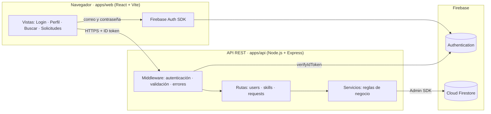

# Arquitectura

## Diagrama de componentes



## Decisiones
1. **Separación interfaz / reglas de negocio / persistencia.** El navegador no escribe en Firestore: todo pasa por la API (requisito del PDF).
2. **El rol vive en Firestore** (`users/{uid}.role`) y lo decide el servidor; las reglas de Firestore bloquean cualquier escritura desde clientes.
3. **Validación en el servidor** con Zod; el frontend solo ayuda a la persona usuaria.
4. **Inyección de dependencias** (`createApp({ db, verifyToken })`) para probar sin Internet.

## Bocetos de las 4 pantallas

```text
┌ Iniciar sesión ────────────┐   ┌ Mi perfil ─────────────────────────────────┐
│ ⏳ SkillBarter             │   │ Nombre público  [______________]            │
│ Correo      [____________] │   │ Sobre mí        [______________]            │
│ Contraseña  [____________] │   │ Habilidades que ofrezco  [Guitarra▾][Avz▾]+ │
│ [ Entrar ]                 │   │ Temas que quiero aprender (Python) (SQL)…   │
│ ¿No tienes cuenta?         │   │ Disponibilidad  [Lun▾][18:00][20:00] +      │
└────────────────────────────┘   │ [ Guardar perfil ]                          │
                                 └─────────────────────────────────────────────┘
┌ Buscar ────────────────────────────┐ ┌ Solicitudes ───────────────────────────┐
│ ¿Qué quieres aprender? [Guitarra▾] │ │ Nueva solicitud [Habilidad▾][60 min▾]  │
│ [ Buscar quién la enseña ]         │ │ [ Descripción… ]  [ Publicar ]         │
│ ┌ Ana Pérez · Avanzado ┐           │ │ Filtros [Todas▾] ☐ Solo mías           │
│ │ Lun 18:00-20:00      │           │ │ ┌ Python · Abierta ┐ ┌ Guitarra … ┐    │
│ └──────────────────────┘           │ └────────────────────────────────────────┘
└────────────────────────────────────┘
```
