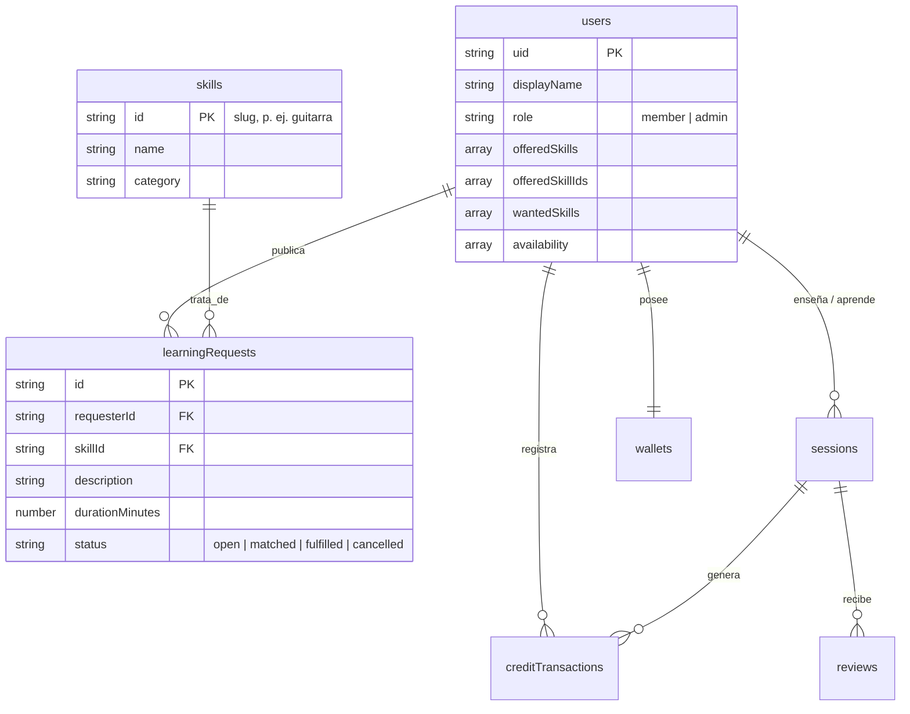

# Modelo de datos en Cloud Firestore

Colecciones sugeridas por el PDF: `users, skills, learningRequests, sessions, wallets, creditTransactions, reviews`.
En **R1** se implementan las tres primeras; las demás se añaden en R2/R3.

## Colección `users/{uid}` (R1)
| Campo | Tipo | Notas |
|---|---|---|
| `displayName` | string | 2–60 caracteres |
| `email` | string | Del token; **nunca** se expone en búsquedas |
| `role` | string | `member` por defecto; solo el servidor lo cambia |
| `bio` | string | ≤ 500 |
| `offeredSkills` | array<{skillId, level}> | `level`: beginner / intermediate / advanced |
| `offeredSkillIds` | array<string> | Copia para consultar con `array-contains` |
| `wantedSkills` | array<string> | ids del catálogo |
| `availability` | array<{day 0-6, start, end}> | Horas `HH:MM` |
| `disabled`, `ratingSum`, `ratingCount`, `ratingAvg` | — | Moderación y reputación |
| `createdAt`, `updatedAt` | timestamp | `serverTimestamp()` |

## Colección `skills/{slug}` (R1)
`name`, `category`, `createdAt`. El id es un *slug* legible (`guitarra`, `ingles-conversacional`).

## Colección `learningRequests/{id}` (R1)
`requesterId`, `requesterName`, `skillId`, `skillName` (copia para mostrar), `description` (10–500), `durationMinutes` (30/60/90/120), `status`, `createdAt`, `updatedAt`.

## Colecciones previstas (R2/R3)
- `sessions/{id}`: docente, alumno, habilidad, `startAt`, `durationMinutes`, `status` (pending → accepted → completed…), `history[]`.
- `wallets/{uid}`: `balanceMinutes` (el saldo se guarda en **minutos enteros** para evitar errores de redondeo).
- `creditTransactions/{id}`: libro mayor; ids deterministas (`session_<id>_debit/credit`).
- `reviews/{sessionId_autorId}`: una valoración por persona y sesión.
